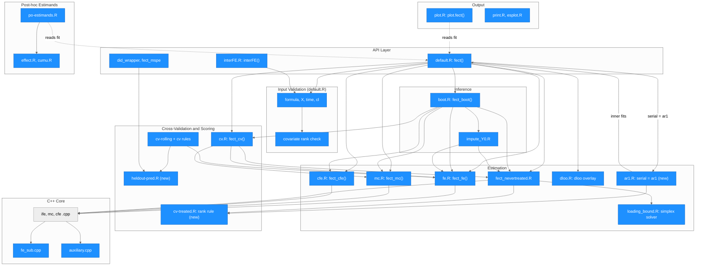
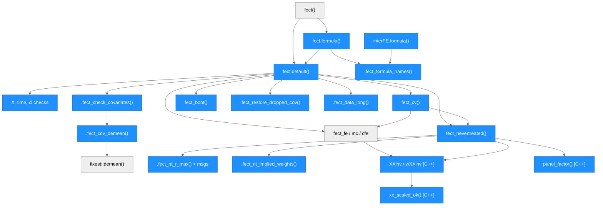
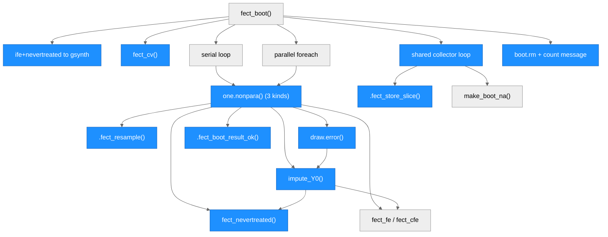
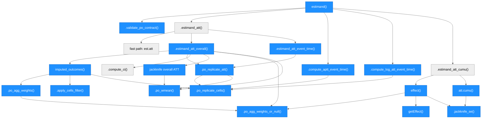
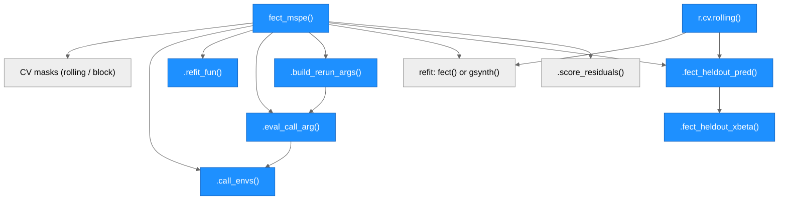
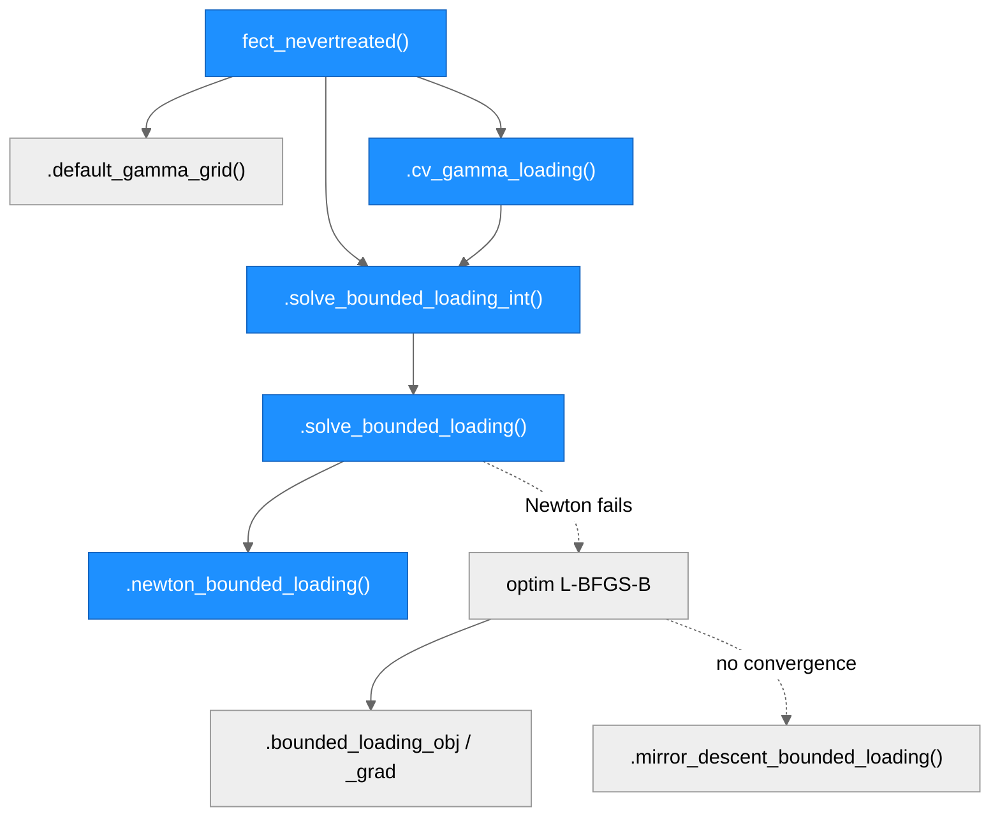
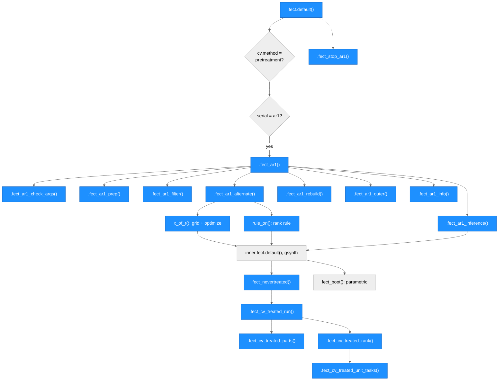
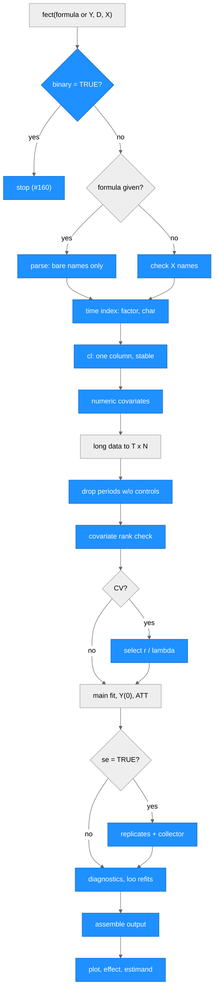
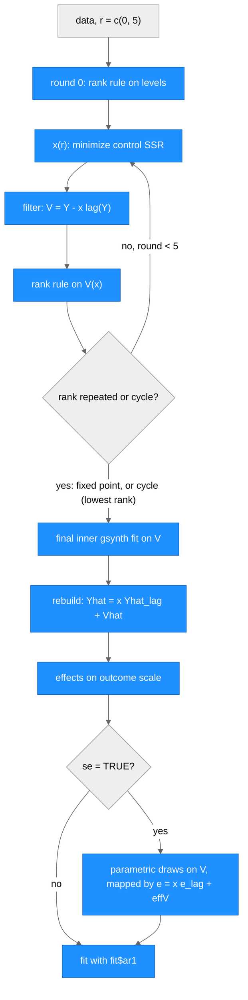

# Architecture — fect

> Generated by scriber for run `2026-09-24-fix246-correctness` on 2026-09-25 (fect 2.4.6, branch
> `fix/246-correctness`). Replaces the 2026-04-30 regeneration (v2.4.1, with manual v2.4.2 patches).
> Blue nodes and "yes" rows mark what this run changed: the correctness fixes A1-A7, B1-B9 (with
> B8b-B8e) and C1-C6 listed in `NEWS.md` under fect 2.4.7, with two amendments made after review:
> C5b (the trigger of the C++ `XXinv()` guard) and C4b (a warning for factor time indices).
>
> Updated on 2026-09-25 for branch `fix/246-followup` (run `2026-09-25-port-onto-151`), which adds five
> fixes on top of PR #151: B10-cfe, B11, B12, B13 and M1 (also in `NEWS.md` under 2.4.7). Rows, nodes
> and notes marked "follow-up" describe them; blue nodes include them.
>
> Updated on 2026-09-26 for the final batch on PR #151 (run `2026-09-25-pr151-final-batch`), which
> adds nine fixes: J1 (jackknife SE of the cumulative ATT), J2 (jackknife SE of `estimand()`'s
> overall ATT), W1 (aggregation weights in `estimand()` and `effect()`), S1 (normal intervals in
> `effect()`), S2 and S4 (`fect_mspe()` refits), S3 (`est.cm`), S5 (`interFE()`) and P1 (p-values of
> parametric fits with `ci.method = "basic"`), and sets the version to 2.4.7 (2.4.6 was a development
> version on GitHub, never on CRAN). Rows, nodes and notes marked "final" describe them.
>
> Updated on 2026-09-27 for the follow-up batch on PR #151 (run `2026-09-26-pr151-followups`), which
> fixes fect #152-#161 and #163: the data lookup of `fect_mspe()` (#152), the first row of `att.cumu()`
> (#153), the weighted jackknife placebo and carryover slots (#154), `est.group.att` under `ci.method`
> (#155), `att.avg.unit` on panels with missing cells (#156), the slots of `normalize = TRUE` fits
> (#157), the basic p-values of bootstrap fits (#158), `estimand()` on jackknife fits (#159),
> `binary = TRUE` (#160), `estimand()`'s stops (#161), and the prediction that `fect_mspe()` and
> `r.cv.rolling()` score (#163, new file `R/heldout-pred.R`). Rows, nodes and notes that cite these
> issue numbers describe them; blue nodes include them.
>
> Updated on 2026-10-16 for branch `fix/248-combined` (run `2026-10-16-fect-248-combined`), which sets
> the version to 2.4.8 and holds three fixes: the joint fit of each treated unit's intercept under
> `loading.bound = "simplex"` (`R/loading_bound.R`, `R/fect_nevertreated.R`), `did_wrapper()` needing
> did 2.5.1 or later for the Callaway-Sant'Anna methods (#178), and the F test returning `NA` instead of
> stopping when its pre-treatment window has one treated unit or one period (#179). Rows, nodes and
> notes marked "2.4.8" describe them; blue nodes include them. Call graph 5 and the section "Contracts
> introduced in 2.4.8" are new.
>
> Updated on 2026-10-16 (run `2026-10-16-fect-ar1-joint`, same branch) for two gsynth features: the
> treated-unit rank rule, `cv.method = "pretreatment"` (new file `R/cv-treated.R`), and the AR(1)-filtered
> estimator, `serial = "ar1"` (new file `R/ar1.R`), with a parametric bootstrap conditional on the chosen
> filter coefficient and rank. Call graph 6, the module diagram nodes `E7` and `K3`, and the section
> "`serial = "ar1"` and the treated-unit rank rule" under "Contracts introduced in 2.4.8" are new. The
> argument value `"pretreatment"` and the argument `serial` are provisional names (see Notes). Stage 2 (same
> run, build `57bb66f`) adds the cycle rule of the alternation (`.fect_ar1_alternate()`), the handling of inner
> EM fits that do not converge, no lag mask at `x` exactly 0, and the simulation findings in the contracts.

## Overview

fect is an R package for causal panel analysis with binary treatments under parallel trends
(Fixed Effects Counterfactual Estimators). Its core abstraction is counterfactual imputation: fit an
outcome model on untreated cells, impute the missing potential outcomes Y(0) of treated cells, and
average the gaps Y - Y(0) into the ATT and its by-period, by-cohort and cumulative summaries. The
package is an R/C++ hybrid: R (`R/`, 39 files, about 37,900 lines) does input handling, data
reshaping, cross-validation, inference and output; C++ via Rcpp and RcppArmadillo (`src/`, 11 files
plus a header, about 5,000 lines) does the linear algebra (SVD, EM iterations, demeaning, factor
extraction). Estimators: two-way FE, interactive fixed effects (IFE, and gsynth, its never-treated
form), matrix completion (MC) and complex fixed effects (CFE). Inference: unit (cluster) bootstrap,
jackknife, and a parametric bootstrap for the gsynth setting. Post-hoc estimands (cumulative ATT,
APTT, log-ATT) are computed from the saved replicate draws. Key dependencies: fixest (initial
fits, covariate demeaning), MASS (`ginv`), future / doFuture / doRNG / foreach (parallel
bootstrap), ggplot2 and GGally (plots), mvtnorm (parametric errors). Version 2.4.8 (unreleased; 2.4.7 was a development version and is part of it).

---

## Module Structure

> One unified diagram. The "Input Validation" layer is a set of helpers inside `R/default.R` (new in
> this run, except the older `index`/`W`/`group.fe` checks). `O2` is blue because `print.R` changed;
> `esplot.R` did not. `A3` is blue for the follow-up M1 and the final S2 and S4 (`fect_mspe.R`); `did_wrapper.R` did not
> change. Follow-up batch: `H1` (`R/heldout-pred.R`) is new, called by `fect_mspe()` (in `A3`) and
> `r.cv.rolling()` (in `K2`) to build the prediction they score (#163); `E1`-`E3` are blue for #156
> (and `fe.R` for #157), `E5` (`dloo.R`) for #158. `E6` (`R/loading_bound.R`, the bounded-loading
> solver) is shown for 2.4.8: `fect_nevertreated()` (`E4`) is its only caller, and `fect_cv()`, `fect_boot()`
> and `impute_Y0()` reach it through `E4`. The AR(1) run adds `E7` (`R/ar1.R`) and `K3` (`R/cv-treated.R`).
> `fect.default()` hands a `serial = "ar1"` call to `E7` before any other processing; `E7` calls
> `fect.default()` again (`serial = "none"`, `method = "gsynth"`) for every inner fit, so the inner fits,
> the rule and the bootstrap reuse `E4`, `K3` and `I1` unchanged. `E4` calls `K3` when
> `cv.method = "pretreatment"`; `K3` holds the rule's arithmetic as pure functions on matrices.

### Module Reference

| Module / File | Layer | Purpose | Key Exports | Changed in this run |
| --- | --- | --- | --- | --- |
| `R/default.R` (4,399 lines) | API + Validation | `fect()` generic, formula and default methods: input checks, reshaping to T x N matrices, CV / fit / bootstrap routing, diagnostics, output assembly | `fect()` | yes: A2 (stores `vartype`), A6 (`cl` checks, parametric warning), B5 (`wgt.implied` dimnames), B7, B8, B8b-d (loo refit arguments), B9, C1-C6, C4b; follow-up: B10-cfe (`dloo` with never-treated fitting stops in the argument checks), B13 (stores the `W.agg` matrix); final: S3 (`cm` reaches the fit without SEs; the `cm` model is fitted after cross-validation; `cm` with never-treated controls stops); follow-up batch: #157 (`Y.dat` and the stored covariate array on the outcome's scale under `normalize = TRUE`), #160 (`binary = TRUE` stops in the `fect()` generic); 2.4.8, AR(1): `serial = c("none", "ar1")` in `fect()`, `fect.formula()` and `fect.default()`; the `"pretreatment"` guard (stops for any method but gsynth, for weights, `loading.bound`, `cv.rule != "min"`, `criterion != "mspe"`), then the `serial` dispatch to `.fect_ar1()` before any other processing |
| `R/interFE.R` (570) | API | Standalone interactive fixed effects estimator | `interFE()` | yes: C1, C2 (formula parser, `X` with formula), C6 (absorbed-covariate labels); final: S5 (stops for a covariate absorbed by the intercept, or by the unit and time effects together); #160 (`binary = TRUE` stops in the `interFE()` generic; the file keeps CRLF line endings) |
| `R/did_wrapper.R` (674), `R/fect_mspe.R` (468) | API | DID estimator wrappers; MSPE model comparison | `did_wrapper()`, `fect_mspe()` | follow-up: M1 (`fect_mspe()` refits no longer pass the call's `Y`, `D`, `X`; the rebuilt formula carries them); final: S2 (each fit is refitted with the function that made it, e.g. `gsynth()`), S4 (the call's data and arguments are evaluated where `fect_mspe()` is called, then in the formula's environment); #152 (the data lookup accepts only a data frame, so a function named like the data is skipped), #163 (scores the model's full prediction at the held-out cells through `.fect_heldout_pred()`); 2.4.8, #178 (`did_wrapper(method = "cs_never")` and `"cs_notyet"` stop with a message when did is older than 2.5.1, which reported unestimable cohort-period cells as 0 on unbalanced panels) |
| `R/po-estimands.R` (2,334) | Post-hoc | `imputed_outcomes()` long-form accessor and `estimand()` dispatcher; replicate alignment helpers | `estimand()`, `imputed_outcomes()` | yes: A1 (`.po_replicate_cells()`, `.po_replicate_att()`, `cells` scoping), A6 (slot contract allows padded arrays); follow-up: B13 (`.po_agg_weights()`); final: W1 (`.po_agg_weights_or_null()`, `.po_wmean()`: every cell-based estimand of a weighted fit is weighted by `fit$W.agg`; one `weights` check in `estimand()`), J2 (jackknife overall SE from `att.avg.boot`); #159 (jackknife fits default to `ci.method = "normal"` for every type), #161 (`.estimand_by_stop()`; `cells` with `"att.cumu"` stops; the stop messages name the cause) |
| `R/effect.R` (450), `R/cumu.R` (272) | Post-hoc | Cumulative / subgroup effects (soft-deprecated) | `effect()`, `att.cumu()` | yes: A2 (stored `vartype`, `drop = FALSE`, parametric normal CI in `att.cumu()`), A6 (replicate width); follow-up: B11 (running sum of the per-period ATTs); final: J1 (`.jackknife_se()` in both), S1 (`effect()`: normal intervals for parametric and jackknife fits), W1 (`getEffect()` weights); #153 (`att.cumu()` fills every row from `att.cumu.sub()`, the first included; a window of one event time keeps a matrix) |
| `R/fe.R` (985), `R/mc.R` (813), `R/cfe.R` (1,179) | Estimation | IFE / FE, matrix completion, complex FE fits | internal | follow-up batch: #156 (per-unit ATT over each unit's observed treated cells, in all three), #157 (`fe.R`: `est.cm` rescaled like `est` under `normalize = TRUE`) |
| `R/fect_nevertreated.R` (3,753) | Estimation | Never-treated estimators (gsynth, IFE and CFE with `time.component.from = "nevertreated"`), their CV, implied weights | internal | yes: A7 (degenerate solves stop), B1 (`"pc"`), B2 (CV cap), B3 (skip messages), B4 (`W.cvfit`), B5 (`.fect_nt_implied_weights()`); follow-up: B12 (one treated unit in the CFE branch); #156 (per-unit ATT over observed cells); 2.4.8: the bounded-loading block (`use_bounded`) fits each treated unit's intercept jointly with its loadings in all three branches and in the gamma CV, through `.solve_bounded_loading_int()`; 2.4.8, AR(1): `"pretreatment"` in `allowed`; with `cv.method = "pretreatment"` the candidate-rank fits are made first at the user's `tol`, `.fect_cv_treated_run()` scores them once, and the serial loop fills `CV.out[, "MSPE"]`, `r.cv` and `fit$cv.treated` from the table (ranks above `Rbar` are `NA`) |
| `R/dloo.R` (719) | Estimation | Double leave-one-out pre-trend overlay (closed form, no refits) | internal | #158 (basic p-values of `pre.est.att` through `.pvalue_basic_dual()`, as `loo` gets them from `fect_boot()`) |
| `R/cv.R` (2,124) | CV | `fect_cv()`: selection of `r` / `lambda`; delegates never-treated CV to `fect_nevertreated()` | internal | yes: B1 (`"pc"` table), B4 (`W.in.fit` forwarded), B8 (`loading.bound` arguments); #156 (per-unit ATT over observed cells); 2.4.8, AR(1): for `"pretreatment"` only, the gsynth delegation passes the call's `max.iteration` and the `r.end >= T0.min` cut is skipped |
| `R/cv-rolling.R` (417), `R/cv-rule-helpers.R` (127), `R/cv-helpers.R` (554), `R/cv_binary.R` (441) | CV | Rolling CV, 1se / min / 1pct rules, fold helpers, binary CV | `r.cv.rolling()` | #163 (`cv-rolling.R`: each held-out block is scored with `.fect_heldout_pred()`, not `Y.ct.full`) |
| `R/heldout-pred.R` (102) | CV / scoring | The model's full prediction at held-out cells, for `fect_mspe()` and `r.cv.rolling()` | internal | new (#163) |
| `R/boot.R` (5,094) | Inference | `fect_boot()`: bootstrap, jackknife and parametric replicates, shared collector, SEs and CIs | internal | yes: A3-A7, B8 (bounds in CV and parametric draws), B8e (ife + never-treated routing); follow-up: B10-cfe (cfe + never-treated replicates); final: P1 (`.pvalue.basic()`: effect p-values of parametric fits with `ci.method = "basic"`); follow-up batch: #154 (90% bounds in the weighted jackknife placebo and carryover slots), #155 (the `est.group.att` branch follows `ci.method`), #158 (`.pvalue_basic_dual()`: basic p-values of bootstrap fits, coefficients included, go with the basic interval; subgroup switch-off effects get the normal p-value under `"normal"`) |
| `R/impute_Y0.R` (246) | Inference | Y(0) imputer used by the parametric bootstrap | internal | yes: A4 (`W.in.fit`), B8 (`loading.bound` arguments) |
| `R/valid_controls.R` (34), `R/permutation.R` (264) | Inference | Control screening for the parametric bootstrap; permutation test | internal | no |
| `R/diagtest.R` (233), `R/fittest.R` (636), `R/fect_sens.R` (232), `R/fect_iden.R` (224) | Diagnostics | Pre-trend / placebo / carryover / equivalence tests; sensitivity; identification | `fect_sens()`, `fect_iden()` | 2.4.8, #179: `diagtest.R` (the F test's small-sample factor `(N_bar - q) / ((N_bar - 1) q)` is 0/0 or infinite when `N_bar = 1`, including a one-period window; both branches now test `!is.finite(scale) \|\| scale <= 0` and report `NA` with the existing message); 2.4.8, AR(1): `.fect_stop_ar1()` at the top of `diagtest()`, `fect_sens()`, `fect_iden()` and `fect_mspe()` (and `estimand(test != "none")` in `po-estimands.R`) |
| `R/plot.R` (5,515) | Output | `plot.fect()`, 14+ plot types; the gap plot draws the chosen treated units' gaps when `id` is given, with a band from parametric bootstrap draws (#162) | `plot.fect()` | yes: B6 (NULL-safe `vartype` tests, factors-plot labels); #162 (gap plot with `id`); 2.4.8, AR(1): `.fect_stop_ar1()` on the plot types and options that read levels residuals |
| `R/print.R` (162) | Output | S3 print methods | `print.fect()` | yes: A6 (no "Cluster SE" line for parametric and jackknife fits); 2.4.8, AR(1): the `Serial correlation:` line and the one-step-ahead note after the ATT table |
| `R/esplot.R` (1,229), `R/theme-helpers.R` (42), `R/plot_return.R` (9) | Output | Event-study plots, theme, plot-return class | `esplot()` | no |
| `R/support.R` (733), `R/score.R` (105), `R/getcohort.R` (264), `R/state.R` (7), `R/RcppExports.R` (191) | Utilities | Initial fits, scores, cohorts, session state, Rcpp bindings | `get.cohort()` | no |
| `R/loading_bound.R` (508) | Estimation helper | Simplex-constrained treated loadings (entropy-regularized), gamma cross-validation; 2.4.8 adds the joint intercept fit and a Newton solver for it | internal | 2.4.8: new `.solve_bounded_loading_int()`, `.newton_bounded_loading()`; `.cv_gamma_loading()` gets `intercept`; `.solve_bounded_loading()` gets `newton`; objective, gradient, mirror descent and the gamma grid are unchanged |
| `R/ar1.R` (1,174) | Estimation | `serial = "ar1"`: calendar-time filter, joint choice of the filter coefficient `x` and the rank `r`, rebuild of the outcome-scale counterfactual, conditional parametric bootstrap, the `fit$ar1` slot, `.fect_stop_ar1()` | `.fect_ar1()`, `.fect_stop_ar1()` (internal) | new (2.4.8) |
| `R/cv-treated.R` (229) | CV | The treated-unit rank rule `cv.method = "pretreatment"`: leave-one-pretreatment-period-out tasks, units' losses weighted by their ATT share, candidate set and scored cells fixed before scoring; pure functions on matrices | internal | new (2.4.8) |
| `src/fe_sub.cpp` (307) | C++ | `panel_factor()`, `panel_FE()`, `Y_demean()`, `panel_beta()` | internal | yes: B2 (`panel_factor()` clamps r at min(T, N)) |
| `src/auxiliary.cpp` (455) | C++ | EM helpers, `XXinv()`, `wXXinv()` | internal | yes: C5, C5b (X'X that has full rank after scaling its columns to unit diagonal is inverted as before, whatever the covariates' units; otherwise a scaled generalized inverse instead of an error) |
| `src/ife.cpp` (546), `src/ife_sub.cpp` (617), `src/mc.cpp` (230), `src/cfe.cpp` (210), `src/cfe_sub.cpp` (588), `src/binary_*.cpp` | C++ | IFE, MC, CFE and probit cores | internal | no |

---

## Function Call Graph

### 1. Entry, input validation and the main fit

### 2. Bootstrap: replicates and the shared collector

### 3. Post-hoc estimands: replicate alignment

> Final (W1): `ET`, `AP` and `LA` also call `.po_wmean()` and `.po_agg_weights_or_null()`; the edges
> are left out to keep the graph readable.

### 4. Model comparison and rolling CV: refits and held-out predictions (final S2, S4; #152, #163)

> `r.cv.rolling()` refits with `fect()` only and scores its per-fold MSPE itself; `fect_mspe()` passes
> the predictions to `.score_residuals()`. Both call `.fect_heldout_pred()` only at cells that were
> hidden in the refit (#163).

### 5. Bounded loadings: the simplex solver and the joint intercept (2.4.8)

> With a unit effect (`force` 1 or 3) `.solve_bounded_loading_int(intercept = TRUE)` centres the unit's
> outcome and the factors over the rows it is given, calls `.solve_bounded_loading(newton = TRUE)` on the
> centred data, and adds the intercept. Without a unit effect (`force` 0 or 2) it calls the solver exactly
> as 2.4.7 did and Newton is not used. `fect_boot()`, `fect_cv()` and `impute_Y0()` reach this path
> only through `fect_nevertreated()`. The dashed edges are fallbacks: L-BFGS-B runs only when Newton
> reports failure, and mirror descent only when L-BFGS-B does not converge.

| Function | Defined In | Called By | Calls | Changed | Purpose |
| --- | --- | --- | --- | --- | --- |
| `.solve_bounded_loading_int()` | `R/loading_bound.R` | `fect_nevertreated()` (three branches), `.cv_gamma_loading()` | `.solve_bounded_loading()` | new (2.4.8) | `intercept = TRUE`: `u_c = u - mean(u)`, `F_c` = `F` minus its column means (over the rows passed in), solve the centred problem with the same `gamma`, return `alpha = mean(u) - colMeans(F) . lambda_hat` and `resid_norm` of the centred fit. `intercept = FALSE`: the 2.4.7 call, `alpha = NA`, `resid_norm = sqrt(sum((u - F lambda_hat)^2))` |
| `.newton_bounded_loading()` | `R/loading_bound.R` | `.solve_bounded_loading()` (when `newton = TRUE`) | none | new (2.4.8) | Newton's method on the dual of the strictly convex problem: with `z` the fit residual and `w(z) = softmax(log q + 2 gamma Lambda_co F' z)`, solves `u - z - F Lambda_co' w(z) = 0` in `r` dimensions (Woodbury), halving steps until the gradient falls; stops at max abs gradient <= 1e-13 times max(1, max abs u); returns failure if it cannot reach 1e-9 |
| `.solve_bounded_loading()` | `R/loading_bound.R` | `.solve_bounded_loading_int()` | `.newton_bounded_loading()`, `optim()`, `.mirror_descent_bounded_loading()` | yes (2.4.8: `newton = FALSE` argument) | Entropy-regularized simplex projection; `method` in the result reads `"newton"`, `"lbfgs"` or `"mirror-descent"` |
| `.cv_gamma_loading()` | `R/loading_bound.R` | `fect_nevertreated()` | `.solve_bounded_loading_int()` | yes (2.4.8: `intercept = FALSE` argument) | 5-fold CV of `gamma` over pre-treatment periods. `intercept = TRUE`: each training fold is centred on its own periods, the held-out periods are predicted with `F_te lambda_hat + alpha_train`, a fold needs at least `ncol(F) + 1` training periods; the random draws are the same as in 2.4.7 |

### 6. `serial = "ar1"` and the treated-unit rank rule (2.4.8)

> `x_of_r()` and `rule_on()` are closures inside `.fect_ar1()`; `.fect_ar1_alternate()` is a pure function
> (no data, no fits) that receives them as one `step(r)` callback and decides when to stop. Every inner fit is
> `fect.default(method = "gsynth", serial = "none", ...)` on the filtered data, quiet; the rule is the inner call
> with `CV = TRUE, cv.method = "pretreatment"`, which reaches `fect_nevertreated()` and then
> `.fect_cv_treated_run()`. The same rule serves `serial = "none"` calls with `cv.method = "pretreatment"`: the
> path then ends at `CR`. `.fect_stop_ar1()` is called at the top of the functions listed in the contracts
> below (dashed edge: it is a guard, not part of the fit). Fixed `r` skips `RO` and alternation.

| Function | Defined In | Called By | Calls | Changed | Purpose |
| --- | --- | --- | --- | --- | --- |
| `.fect_ar1()` | `R/ar1.R` | `fect.default()` | `.fect_ar1_check_args()`, `.fect_ar1_prep()`, `.fect_ar1_filter()`, `.fect_ar1_alternate()`, inner `fect.default()`, `.fect_ar1_rebuild()`, `.fect_ar1_outer()`, `.fect_ar1_inference()`, `.fect_ar1_info()` | new | Entry. Reads the five internal options (`fect.ar1.x`, `fect.ar1.rounds`, `fect.ar1.exclude.nonconverged`, `fect.ar1.mask.zero`, and `fect.cv.treated.window` in the rule) once. Round 0: the rule on the unfiltered panel. Then `.fect_ar1_alternate()` runs the rounds. A single `r` fixes the rank and chooses `x` only. Collects the non-convergence flags and issues the wrapper's own warnings; fect's "did not converge" warnings from search fits are muffled and counted |
| `.fect_ar1_alternate()` | `R/ar1.R` | `.fect_ar1()` | the `step` callback | new (stage 2) | The decision logic of the alternation. For k = 1..K (K = 5): `step(r_{k-1})` returns `x_k` and `r_k`. Fixed point (`r_k == r_{k-1}`): `converged`. A rank seen before (not the previous one): `cycled`, `cycle` = the rounds in the cycle, `final` = the round with the lowest rank. Loop ends without either: `capped`. Returns `path`, `final`, `converged`, `cycled`, `cycle`, `capped`, `trace`; the fixed-point test comes before the cycle test |
| `.fect_ar1_check_args()` | `R/ar1.R` | `.fect_ar1()` | none | new | Stops, with a message that contains `serial = "ar1"`, for `method != "gsynth"`, weights, `group`, `cfe`, `Z`, `Q`, `loading.bound`, `binary`, `fill.missing`, placebo, carryover, `loo`, `dloo`, `permute`, `vartype = "jackknife"`, and `cv.method` values other than `"pretreatment"` or the default |
| `.fect_ar1_prep()`, `.fect_ar1_filter()` | `R/ar1.R` | `.fect_ar1()` | none | new | Position of each row on the sorted time grid; `V = v - x * v_lag` for the outcome and each covariate by `match()` on (unit, previous position); a filtered cell is `NA` when it or its lag is `NA`; the first position never exists; `D` is not lagged. `mask = FALSE` (used by the rule, the final fit and the bootstrap when `x` is exactly 0) drops no cell for a missing lag |
| `x_of_r()` | closure in `.fect_ar1()` | `.fect_ar1()` | inner `fect.default()` (via `ssr_at`) | new | Sum of squared control residuals of the rank-r fit to V(x) on a 0.05 grid over [0, 1], one `optimize()` in the bracket around the grid minimum, exact boundary; returns `x` and the profile of every evaluated point |
| `rule_on()` | closure in `.fect_ar1()` | `.fect_ar1()` | inner `fect.default(CV = TRUE, cv.method = "pretreatment")` | new | Rank by the treated-unit rule on V(x) (or on the levels panel for round 0) |
| `.fect_cv_treated_run()` | `R/cv-treated.R` | `fect_nevertreated()` | `.fect_cv_treated_parts()`, `.fect_cv_treated_rank()` | new | With the optional `eligible` argument (set only by the ar1 inner call; default all eligible, output unchanged) a rank whose control fit did not converge cannot be picked; the list then carries `eligible` and `fallback`. Fits the controls at every candidate rank at the user's `tol`, builds each treated unit's offset and pretreatment residuals, runs the rule once; option `fect.cv.treated.window` (`"loo"` or `"fwd"`) selects the window for `MSPE` and `r.cv` |
| `.fect_cv_treated_rank()` | `R/cv-treated.R` | `.fect_cv_treated_run()` | `.fect_cv_treated_unit_tasks()` | new | The rule on matrices: candidate set, `Rbar` (largest rank whose scorable units hold at least 80% of the ATT weight), scored units, scores for both windows, smallest minimizer; same output names as the prototype `treated_rank()` |
| `.fect_cv_treated_parts()`, `.fect_cv_treated_unit_tasks()` | `R/cv-treated.R` | `.fect_cv_treated_rank()` | none | new | Per-unit pretreatment sets and the (train, score) tasks of one unit |
| `.fect_ar1_rebuild()` | `R/ar1.R` | `.fect_ar1()` | none | new | Model prediction `Vhat` at every cell from the inner fit; consistency check against `inner$Y.ct` at 1e-8; anchor `s_i` (last observed pretreatment outcome, from the original `D`); recursion `Yhat_t = x * Yhat_{t-1} + Vhat_t` through unobserved cells (skipped at `x = 0`: `eff` is the inner effect, since `0 * NA` is `NA`); effects; units that cannot be rebuilt |
| `.fect_ar1_outer()` | `R/ar1.R` | `.fect_ar1()` | none | new | Outcome-scale slots on the T-1 grid (`Y.dat`, `eff`, `Y.ct`, `att.avg`, `att`, `count`, ...); the filtered-scale slots stay and are listed in `fit$ar1$v.scale.slots` |
| `.fect_ar1_inference()` | `R/ar1.R` | `.fect_ar1()` | inner `fect.default(se = TRUE, vartype = "parametric", keep.sims = TRUE)` | new | Maps each draw of `eff.boot` through `e_t = x * e_{t-1} + effV_t` from the anchor, recomputes the draw statistics, builds `est.avg`, `est.att` and the rest with fect's own interval rules (local copy of the `.pvalue.basic` wrapper; `.basic_ci_shifted*` and `.pvalue_basic_dual()` are the file-scope ones in `boot.R`) |
| `.fect_ar1_info()` | `R/ar1.R` | `.fect_ar1()` | none | new | Builds `fit$ar1` (`x`, `x.fixed`, `r`, `path`, `converged`, `rounds`, `profile`, `profile.rank`, `rule`, `rule.levels`, `rebuilt`, `not.rebuilt`, `dropped`, `first.period`, `min.T0`, `pre.scale`, `v.scale.slots`, `x.bounds`; stage 2: `cycled`, `cycle`, `final.round`, `em.converged`, `niter`, `excluded`, `fallback.rounds`, `search.nonconverged`, `lag.mask`; `path` and `profile` gain `em.converged`) |
| `.fect_stop_ar1()` | `R/ar1.R` | `diagtest()`, `fect_sens()`, `fect_iden()`, `fect_mspe()`, `estimand()`, `plot.fect()` | none | new | Returns silently unless `fit$serial == "ar1"`; otherwise stops with a message that names `serial = "ar1"` and the feature |

### Function Reference

| Function | Defined In | Called By | Calls | Changed | Purpose |
| --- | --- | --- | --- | --- | --- |
| `fect()` | `R/default.R` | user | `fect.formula()`, `fect.default()` | yes (#160) | S3 generic; `binary = TRUE` stops before dispatch, with a message that binary outcome models are not supported in this version (#160) |
| `interFE()` | `R/interFE.R` | user | `interFE.formula()`, `interFE.default()` | yes (#160) | S3 generic; the same `binary = TRUE` stop (#160) |
| `fect.formula()` | `R/default.R` | `fect()` | `.fect_formula_names()`, `fect.default()` | yes (C1, C2) | Parses the formula (bare names only); stops when `X` is also given |
| `.fect_formula_names()` | `R/default.R` | `fect.formula()`, `interFE.formula()` | — | new (C1) | Returns outcome and right-hand-side names; accepts and ignores intercept terms; names every bad term |
| `fect.default()` | `R/default.R` | `fect()`, `fect.formula()` | checks below, `fect_cv()`, estimators, `fect_boot()`, `diagtest()` | yes (final S3) | Workhorse; see Data Flow for the order of checks. Final S3: stops for `cm = TRUE` with never-treated controls; passes `cm` and `II.cm` to `fect_fe()` without SEs; after cross-validation fits the `cm` model with `r.cv` |
| `.fect_check_covariates()` | `R/default.R` | `fect.default()` (step 7b) | `.fect_cov_demean()`, `qr()` | new (C5, C6) | Finds covariates with no variation on the estimation cells, absorbed by the fixed effects, or aliased (lm's rule, tol 1e-7); returns the positions to drop and one warning |
| `.fect_cov_demean()` | `R/default.R` | `.fect_check_covariates()` | `fixest::demean()` | new (C5, C6) | Removes the model's fixed effects from the covariates on the estimation cells |
| `.fect_restore_dropped_covariates()` | `R/default.R` | `fect.default()` (output) | — | new (C5, C6) | Re-inserts NA rows for dropped covariates in `beta`, `est.beta`, `beta.boot` (and binary `marginal`) |
| `.fect_data_long()` | `R/default.R` | `fect.default()` (output) | — | new (C4) | `data.long` with a factor time column in level order when the time index was a factor whose levels are not increasing numbers |
| `interFE.formula()` | `R/interFE.R` | `interFE()` | `.fect_formula_names()`, `interFE.default()` | yes (C1, C2) | Same parser; stops on `X` with a formula |
| `interFE.default()` | `R/interFE.R` | `interFE()` | C++ `inter_fe()`, `.fect_cov_demean()` | yes (C6; final S5) | Stops on FE-absorbed covariates with correct labels, only for fixed effects in the model; final S5: also when the intercept (`force = "none"`) or the unit and time effects together (`force = "two-way"`) absorb a covariate, with the tolerances of `fect()`'s check; covariates with infinite values are not checked |
| `fect_cv()` | `R/cv.R` | `fect.default()`, `fect_boot()` | `fect_fe()`, `fect_mc()`, `fect_nevertreated()` | yes (B1, B4, B8) | CV of `r` / `lambda`; forwards `W.in.fit` and `loading.bound` to never-treated CV |
| `fect_nevertreated()` | `R/fect_nevertreated.R` | `fect.default()`, `fect_cv()`, `fect_boot()`, `impute_Y0()` | `panel_factor()`, `.fect_nt_*()` helpers, simplex projection (`.cv_gamma_loading()`, `.solve_bounded_loading_int()`) | yes (A7, B1-B5; follow-up B12; 2.4.8 joint intercept) | Never-treated IFE / CFE fits and CV; `r.cv <- r.pc` under `"pc"`; CV range capped at `Nco - 1`; `W.cvfit`; `stop()` instead of 3-field early returns; the CFE helper `.estimate_alpha()` keeps a one-column matrix (`drop = FALSE`), so one treated unit works |
| `.fect_nt_r_max()`, `.fect_nt_cap_message()`, `.fect_nt_no_cv_message()` | `R/fect_nevertreated.R` | `fect_nevertreated()` | — | new (B2, B3) | Cap and messages for the searched range of `r` |
| `.fect_nt_implied_weights()` | `R/fect_nevertreated.R` | `fect_nevertreated()` | `MASS::ginv()` | new (B5) | `ginv(t(Lco)) %*% t(Ltr)` (Nco x Ntr), NULL on failure |
| `fect_boot()` | `R/boot.R` | `fect.default()` (se = TRUE, loo refits) | `fect_cv()`, `one.nonpara()`, `draw.error()`, collector, `.pvalue.basic()` | yes (A3-A7, B8, B8e; follow-up B10-cfe; final P1) | Replicates, collector, `boot.rm`, SEs / CIs; p-values of the effects under `ci.method = "basic"` through `.pvalue.basic()` (final P1) |
| `.pvalue.basic()` | `R/boot.R` (inside `fect_boot()`) | the `ci.method = "basic"` branches of the effect slots (22 sites, among them `est.group.att`, whose branches follow `ci.method` since #155), and the coefficient p-values of bootstrap fits (#158) | `get.pvalue()`, `.pvalue_basic_dual()` | new (final P1; #158) | Bootstrap draws: `.pvalue_basic_dual()` (#158; it was `get.pvalue(draws)`, the percentile p-value). Parametric draws (simulated with no effect): `get.pvalue(draws - mean(draws) - estimate)`, twice the smaller of the shares of the centered draws at or above and at or below the estimate, the test inversion of the shifted basic interval up to the resolution of the draws. Coefficient p-values of parametric fits still use `get.pvalue()` |
| `.pvalue_basic_dual()` | `R/boot.R` (file level) | `.pvalue.basic()`, `R/dloo.R` `.assemble()` | none | new (#158) | Two-sided p-value dual to the basic interval: with the draws sorted (NA dropped) and the type-7 quantile line through ((j - 1)/(n - 1), x[j]), it finds where the line crosses twice the estimate and doubles the smaller tail; below alpha exactly when the (1 - alpha) basic interval excludes 0, at every alpha; NA with fewer than two draws |
| `one.nonpara()` (binary parametric, parametric, nonparametric) | `R/boot.R` (closures) | serial loop, parallel `foreach` | `.fect_resample()`, `impute_Y0()`, estimators, `.fect_boot_result_ok()` | yes (A3, A4, A5, A7, B8; follow-up B10-cfe) | One replicate; parametric: `Y.boot / norm.para[1]` before refit (A3), `W[, id.boot]` (A4); nonparametric: cfe + never-treated replicates refit `fect_nevertreated(method = "cfe")`, like the point fit (B10-cfe) |
| `.fect_resample()` | `R/boot.R` | replicate functions, `draw.error()` | `sample.int()` | new (A5) | `x[sample.int(length(x), size, replace)]`: same draws as `sample()` for length > 1, literal for length 1 |
| `.fect_boot_result_ok()` | `R/boot.R` | replicate functions | — | new (A7) | Rejects replicate results of the wrong shape (counted as failed) |
| `.fect_store_slice()` | `R/boot.R` | collector loop | — | new (A6) | Stores a T x w replicate in a T x W x B array, padding with NA and widening when w > W |
| `impute_Y0()` | `R/impute_Y0.R` | `fect_boot()` (parametric) | `fect_nevertreated()`, `fect_fe()`, `fect_cfe()` | yes (A4, B8) | Forwards `W.in.fit`, `loading.bound`, `gamma.loading`, `gamma.loading.grid` |
| `estimand()` | `R/po-estimands.R` | user | `.estimand_*()` / `.compute_*()`, `.estimand_by_stop()` | yes (A1; final W1; #159, #161) | Typed dispatcher; replicate paths read through `.po_replicate_cells()`; one check at the top: `weights` must be NULL (final W1). `ci.method = NULL` resolves to `"normal"` for every type on a jackknife fit (#159). A `by` value outside the four names stops through `.estimand_by_stop()` (#161) |
| `.estimand_by_stop()` | `R/po-estimands.R` | `estimand()`, `.estimand_att()`, `.estimand_att_cumu()`, `.estimand_aptt()`, `.estimand_log_att()` | none | new (#161) | Stop for a `by` value that is not available in this release; names the values that work (`"event.time"` or `"overall"` for `"att"` and `"att.cumu"`, `"event.time"` for `"aptt"` and `"log.att"`) |
| `.estimand_att_cumu()` | `R/po-estimands.R` | `estimand()` | `.compute_att_cumu_event_time()`, `.compute_att_cumu_overall()` | yes (#161) | `cells` given without `window` stops and points to `window` (it was ignored with `by = "overall"`); `window` needs `by = "overall"` |
| `.estimand_att_overall()`, `.estimand_att_event_time()` (placebo / carryover), `.estimand_att_event_time_jackknife()` | `R/po-estimands.R` | `.estimand_att()` | `.po_wmean()`, `.po_replicate_att()`, `.compute_ci()` | yes (final W1) | Weighted estimate and replicates for a weighted fit; weighted `.cell_jackknife()` for BCa |
| `.estimand_att_overall_jackknife()` | `R/po-estimands.R` | `.estimand_att_overall()` | `.po_wmean()` | yes (final J2, W1) | Tukey SE from `att.avg.boot`, each leave-one-out fit's overall ATT (was `att.avg.unit.boot`, the average of unit-level ATTs); with a `cells` filter, recomputes each replicate with the weights `W[, -j]` |
| `.compute_aptt_event_time()`, `.compute_log_att_event_time()` | `R/po-estimands.R` | `.estimand_aptt()`, `.estimand_log_att()` | `.po_replicate_cells()`, `.po_wmean()` | yes (final W1) | Weighted numerator and denominator (APTT) and weighted mean log difference, in the estimate and in every replicate |
| `.cell_jackknife()` | `R/po-estimands.R` | BCa intervals | none | yes (final W1) | With weights `w`: leave-one-out means `(sum(w v) - w_i v_i) / (sum(w) - w_i)` |
| `.po_replicate_cells()` | `R/po-estimands.R` | `imputed_outcomes()`, `.po_replicate_att()`, APTT, log-ATT | — | new (A1) | Maps a T x N cell mask into replicate b through `colnames.boot[[b]]`; returns the draws and their source cells |
| `.po_replicate_att()` | `R/po-estimands.R` | overall and event-time ATT | `.po_replicate_cells()`, `.po_wmean()` | new (A1; final W1) | Per-replicate mean, weighted by `W[rc$orig]` for a weighted fit (each draw takes the weight of its source cell); empty replicate gives NA |
| `.validate_po_contract()` | `R/po-estimands.R` | `estimand()`, `imputed_outcomes()` | — | yes (A6) | Accepts arrays wider than N when `colnames.boot` gives each width |
| `.apply_cells_filter()` | `R/po-estimands.R` | `imputed_outcomes()` | `eval()` | yes (A1) | Evaluates a `cells` formula in `environment(cells)` |
| `imputed_outcomes()` | `R/po-estimands.R` | user, `.estimand_att_overall()` | `.po_replicate_cells()`, `.po_agg_weights()` | yes (A1; follow-up B13) | Replicate rows are each replicate's own cells; the `W.agg` column comes from `.po_agg_weights()` |
| `.po_agg_weights()` | `R/po-estimands.R` | `imputed_outcomes()` | `.po_agg_weights_or_null()` | new (follow-up B13; final W1) | TT x N aggregation weights, 1 where the fit is unweighted |
| `.po_agg_weights_or_null()` | `R/po-estimands.R` | `.po_agg_weights()`, `effect()`, the estimand paths | none | new (final W1) | `fit[["W.agg", exact = TRUE]]`; for fit objects made before that slot existed, the TT x N matrix stored under the name "W" when `W.in.agg`; otherwise NULL, and every path then runs its old unweighted expressions |
| `.po_wmean()` | `R/po-estimands.R` | estimand paths, `.po_replicate_att()` | none | new (final W1) | `mean(v, na.rm = TRUE)` when `w` is NULL; else `sum(w v) / sum(w)` over entries where both are present; NA when none is left or the weights sum to 0 |
| `effect()` | `R/effect.R` | user, `.compute_att_cumu_event_time()` | `getEffect()`, `.jackknife_se()`, `.po_agg_weights_or_null()` | yes (A2, A6; follow-up B11; final S1, J1, W1) | Reads `x$vartype`; slices each replicate to its real width; `getEffect()` builds the cumulative series as the running sum of the per-period means, NA from an event time with no treated cell on. Final: jackknife SE by `.jackknife_se()` row by row (J1); normal interval and p-value for parametric and jackknife fits (S1); the weights, mapped through `colnames.boot` for each replicate, go to `getEffect()` (W1) |
| `getEffect()` | `R/effect.R` | `effect()` | none | yes (follow-up B11; final W1) | Per-period means over the selected treated cells, weighted by `W` when given, and their running sum |
| `att.cumu()` / `att.cumu.sub()` | `R/cumu.R` | user, `.compute_att_cumu_overall()` | `.jackknife_se()` | yes (A2; follow-up B11; final J1) | Parametric fits: normal CI and p-value; jackknife fits: `.jackknife_se()` with a normal CI and p-value (final J1); `weighted = FALSE` (default): running sum, and a replicate missing an event time of the window is dropped; `weighted = TRUE`: the count-weighted number, identical to 5afa708; works on fits without SEs. #153: with SEs every row, the first included, comes from `att.cumu.sub()` (the first row copied `fit$est.att`); `att.cumu.sub()` subsets the replicate matrices with `drop = FALSE`, so a window of one event time works |
| `.jackknife_se()` | `R/cumu.R` | `att.cumu.sub()`, `effect()` | `stats::var()` | new (final J1) | Tukey jackknife SE from leave-one-unit-out replicates, as `jackknifed()` in `R/boot.R`: pseudo-values `B * est - (B - 1) * reps` over the finite replicates, `sqrt(var(pseudo) / n)`; NA with fewer than two |
| `.build_rerun_args()` | `R/fect_mspe.R` (inside `fect_mspe()`) | `fect_mspe()` | `.eval_call_arg()` | yes (follow-up M1; final S4) | Arguments of each refit: the rebuilt formula plus the call's other arguments, without `Y`, `D`, `X` (#151's C2 stops on `X` given with a formula); final: each argument is evaluated by `.eval_call_arg()` |
| `fect_mspe()` | `R/fect_mspe.R` | user | `.call_envs()`, `.eval_call_arg()`, `.refit_fun()`, `.build_rerun_args()`, CV mask builders, `.fect_heldout_pred()`, `.score_residuals()` | yes (follow-up M1; final S2, S4; #152, #163) | Hides held-out cells, refits each model with its own function, scores the model's full prediction at the held-out cells (#163; it read the refit's `Y.ct.full`); data: the data frame a gsynth fit stores (`fit[["data", exact = TRUE]]`), else the call's `data` |
| `.call_envs()`, `.eval_call_arg()` | `R/fect_mspe.R` (inside `fect_mspe()`) | `fect_mspe()`, `.build_rerun_args()` | `eval()` | new (final S4); #152 | Where the stored call is evaluated: the frame `fect_mspe()` was called from, then the environment of `fit$formula`; the first that evaluates wins, else a stop that names the argument. #152: `.eval_call_arg(expr, envs, what, accept = NULL)`; the data call passes `accept = is.data.frame`, so a value that is not a data frame (the function `df`) is skipped and the next environment tried; the stop then says the name is not a data frame |
| `r.cv.rolling()` | `R/cv-rolling.R` | user | `fect()`, `.fect_heldout_pred()`, cv rules | yes (#163) | Rolling-window CV of `r`; each fold's held-out block is scored with `.fect_heldout_pred()` (it read `fit$Y.ct.full`); a cell with no prediction (NA) is left out |
| `.fect_heldout_pred()` | `R/heldout-pred.R` | `fect_mspe()`, `r.cv.rolling()` | `.fect_heldout_xbeta()` | new (#163) | Prediction at hidden cells, `base + X beta`. `base`: `Y.ct.full` (or `Y.ct`) on not-yet-treated paths; on the never-treated path, `est$fit` for control units and `mu + alpha.tr + xi + F lambda.tr` for treated units (NA for a treated unit of a cfe fit with Z, Q or extra index fixed effects, whose terms the fit does not store). The fit is not changed |
| `.fect_heldout_xbeta()` | `R/heldout-pred.R` | `.fect_heldout_pred()` | none | new (#163) | The covariates `fit$X` of the cells, read with `[[` from the scorer's data rows (data.frame, tibble and data.table alike), times `fit$beta`; an NA coefficient adds 0; a missing covariate gives NA, so the cell is not scored |
| `.refit_fun()` | `R/fect_mspe.R` (inside `fect_mspe()`) | `fect_mspe()` | `get0(mode = "function")` | new (final S2) | `fect` for calls to `fect`, `fect.formula`, `fect.default`; otherwise the function named in the stored call (a gsynth fit stores gsynth's), found from the caller's frame; else a stop |
| `plot.fect()` | `R/plot.R` | user | ggplot2 | yes (B6) | `identical(x$vartype, "parametric")`; factors-plot label positions |
| `print.fect()` | `R/print.R` | user | — | yes (A6) | No "Cluster SE" line for parametric and jackknife fits (they ignore `cl`) |
| `panel_factor()` | `src/fe_sub.cpp` | C++ IFE cores | Armadillo SVD | yes (B2) | `r_use = min(r, T, N)` |
| `XXinv()`, `wXXinv()` | `src/auxiliary.cpp` | C++ cores | `xx_scaled_ok()`, Armadillo | yes (C5, C5b) | Build X'X (weighted in `wXXinv()`) as before; if it has full rank after column scaling, return `inv()` / `inv_sympd()` of the unscaled X'X, as at 412d7ae; otherwise `D pinv(D X'X D) D`, a symmetric generalized inverse; X'X with non-finite entries takes the old path |
| `xx_scaled_ok()` | `src/auxiliary.cpp` (static) | `XXinv()`, `wXXinv()` | `arma::rcond()` | new (C5b) | Scales X'X to unit diagonal, `D = diag(1 / sqrt(diag(X'X)))` (1 for an all-zero covariate); true when every diagonal entry is positive and rcond of the scaled matrix > 1e-12 |

---

## Data Flow

| Step | Where | What happens (2.4.7; 2.4.8 rows marked) |
| --- | --- | --- |
| binary | `fect()` and `interFE()` generics | `binary = TRUE` stops before dispatch; the probit code stays in place, unreachable (#160) |
| parse | `fect.formula()`, `.fect_formula_names()` | Outcome, treatment, covariates from bare names; `X` with a formula stops (C1, C2) |
| check X names | `fect.default()` | Duplicates, `X` naming Y or D, missing columns stop (C2) |
| time index | `fect.default()` right after `time <- index[2]` | Factor: increasing numeric levels become numbers, other levels become positions with `time.labels`, with a warning when the levels are numbers out of numeric order (C4b); character must parse as numbers (C4) |
| cl | `fect.default()` | One column name that exists; with the cluster bootstrap, constant within units and at least two clusters (A6) |
| numeric covariates | `fect.default()` after the column subset | Logical to 0/1; factor, character, Date stop (C3) |
| drop periods | `fect.default()` step 2 | Periods with no control are dropped; if no treated cell is left, stop (B7) |
| rank check | `fect.default()` step 7b | `.fect_check_covariates()` on the estimation cells; dropped covariates leave `X` before every later fit (C5, C6) |
| select r / lambda | `fect_cv()` / `fect_nevertreated()` | `"pc"` rule, CV cap, `W.agg` kept out, bounds honoured (B1-B4, B8); serial seed as `se = FALSE` (B9) |
| replicates | `fect_boot()` | Routing (B8e), replicate checks (A7), resampling (A5), parametric scale and weights (A3, A4), collector with padding (A6), count message; cfe + never-treated replicates use the never-treated model (follow-up B10-cfe); p-values of the effects of parametric fits under `ci.method = "basic"` (final P1); per-unit ATT over observed cells (#156); 90% bounds in the weighted jackknife placebo and carryover slots (#154); `est.group.att` follows `ci.method` (#155); basic p-values of bootstrap fits go with the basic interval, subgroup switch-off p-values under `"normal"` are normal (#158) |
| bounded loadings (2.4.8) | `fect_nevertreated()`, inside "select r / lambda" and "main fit" | With `loading.bound = "simplex"`, each treated unit's loadings are solved with its intercept fitted jointly when `force` has a unit effect (call graph 5); `gamma` is chosen by the same centred CV; bootstrap, parametric and loo refits inherit it |
| loo refits | `fect.default()` loo block | Refits keep `loading.bound`, `time.component.from`, `para.error` (B8b-d); their replicates follow the routing above (follow-up B10-cfe) |
| assemble | `fect.default()` output | NA rows for dropped covariates, `wgt.implied` dimnames, `remove.id`, `vartype`, labelled `rawtime` / `data.long`; the `W.agg` matrix when `W` or `W.agg` weights the aggregation (follow-up B13); `est.cm` for `cm = TRUE` fits without SEs or after cross-validation (final S3; `cm` with never-treated controls stops in the argument checks); with `normalize = TRUE`, `Y.dat`, `est.cm` and the stored covariate array on the outcome's scale (#157) |
| post-hoc | `po-estimands.R`, `effect.R`, `cumu.R`, `plot.R`, `fect_mspe.R` | Replicates read through `colnames.boot` (A1, A6); stored `vartype` (A2); NULL-safe plots (B6); cumulative ATT as a running sum (follow-up B11); weights of weighted fits in `estimand()` and `effect()` (final W1); jackknife SEs and normal intervals (final J1, J2, S1); `fect_mspe()` refits with the fit's own function, evaluating its call where it is called (final S2, S4); the data lookup skips values that are not data frames (#152); `fect_mspe()` and `r.cv.rolling()` score the model's full prediction at held-out cells (#163); every row of `att.cumu()` by one rule (#153); `estimand()` defaults on jackknife fits and its stops (#159, #161) |

---

## Data flow of `serial = "ar1"`

> With a single `r`, `R0` and `RK` are skipped and `XS` runs once at that rank. The internal option
> `fect.ar1.x` skips `XS` and fixes `x`; `fect.ar1.rounds = 1` gives the one-round pipeline of the prototype.

## Contracts introduced in 2.4.8

### Bounded loadings and the intercept (`loading.bound = "simplex"`)

- **Shift invariance.** Bounded fits are invariant to adding a constant to a treated unit's outcome
  when `force` has a unit effect (`force = "unit"` or `"two-way"`): the loadings, the simplex
  weights (`wgt.implied`), the CV-chosen `gamma.loading`, `loading.proj.resid` and the ATT do not
  change, and that unit's `alpha.tr` moves by the constant. This holds to floating point (the tests
  check 1e-8; the typical difference is below 1e-12). It does not hold without a unit effect
  (`force = "none"` or `"time"`): there is no intercept to absorb the level.
- **Joint minimiser.** For each treated unit the code returns the minimiser of
  `(1/gamma) KL(w || q) + || u - alpha 1 - F Lambda_co' w ||^2` over `alpha` and the simplex weights
  `w`, where `u` is the unit's residual after the grand mean, the covariates and the time effects,
  `F` the estimated factors at the unit's training periods and `q` the uniform reference. `alpha` is
  profiled out: the profiled problem is the 2.4.7 problem on `u` and `F` centred over the unit's own
  training periods, with the same `gamma`. The intercept is not bounded.
- **Which periods are centred.** Balanced panels: the common pre-treatment window. Unequal windows:
  the unit's own window. Missing cells: the unit's observed pre-treatment periods
  (`time.pre[[i]]`). In the gamma CV: the training folds only, never the held-out periods.
- **Solver.** With an intercept the centred problem is solved by Newton's method on the dual, whose
  answer does not depend on an iterative solver's stopping rule; L-BFGS-B (then mirror descent) is the
  fallback when Newton does not converge. Known limit: in a test of 3,360 random problems, 4 at
  `gamma = 1e6` used the fallback; they are never worse than 2.4.7's solution, and their loadings are
  shift-invariant to 2.1e-8 at worst, above the 1e-8 target.
- **Unchanged.** `loading.bound = "none"`, and `force = "none"` or `"time"` with `"simplex"`
  (byte-identical to 2.4.7 for a fixed `gamma.loading` and for CV with the same seed).
- **Outputs that change values with a unit effect.** `lambda.tr`, `alpha.tr`, `eff`, the ATT slots,
  `wgt.implied`, `loading.proj.resid` (now the norm of the joint-fit residual), and the `gamma.loading`
  that CV picks. The slot layout is unchanged.

### `serial = "ar1"` and the treated-unit rank rule

- **Unchanged without the options.** With `serial = "none"` and `cv.method != "pretreatment"` every existing output
  is unchanged. `cv.method = "treated"` still partial-matches `"treated_units"`; the new value shares no prefix
  with an existing one (`"pre"` selects it). The value is rejected in `fect.default()` before any dispatch unless
  `method = "gsynth"`, so `fect_cv()` (non-gsynth), `fect_binary_cv()` and `fect_mspe()` never see it.
- **Calendar-time filter.** The lag of a row is the same unit's row at the previous position of the sorted unique
  time values, so a calendar year that no unit has is not a period. A filtered cell is missing when the cell or its
  lag is missing, and the first position never exists. The missing pattern of V does not depend on `x`.
- **Unit-effect invariance.** With a unit effect (`force` 1 or 3), adding a constant to one unit's outcome, treated
  or control, changes no `eff` (tested at 1e-8): the constant is absorbed by that unit's `alpha` in V.
- **`x = 0` equals levels.** `x = 0` is gsynth in levels on the panel without its first period, on every panel:
  `att.avg`, `eff`, `est.avg`, `att.boot` and `eff.boot` equal those of `fect(serial = "none")` on that panel with
  the same seed (4.4e-16 on balanced panels; to the EM tolerance with missing cells). At `x` exactly 0 the rule, the
  final fit and the bootstrap use the panel with no cell dropped for a missing lag (`fit$ar1$lag.mask` is `FALSE`;
  the internal option `fect.ar1.mask.zero = TRUE` restores the mask). For every `x > 0` a cell whose lag is missing
  is missing in V, and the profile (the x-step, including its point at 0) always uses that common masked set, so SSR
  is compared across `x` on one set of cells. The estimator is therefore discontinuous at `x = 0` on panels with
  missing cells. Before stage 2 the mask applied at 0 as well, which lost cells for nothing and produced a runaway
  fit in simulation cell H1 (RMSE ratio 1.76; 1.08 after).
- **The recursion anchor.** For each treated unit, `s_i` is the last period with `D = 0` and the original `Y`
  observed, read from the original data and not from the inner fit (the inner fit shows `D = 0` at cells whose filtered row does not
  exist, which would move the anchor). `Yhat_{s_i} = Y_{s_i}`, and for every later period, observed or not,
  `Yhat_t = x * Yhat_{t-1} + Vhat_t`; `Y` itself is never used after `s_i`. A missing `Vhat` ends the chain
  (`NA` from there). A noiseless panel with errors `e_t = rho^(t-1) e_1` and `x = rho` returns the true effect to 8e-14,
  with staggered adoption, a missing `Y` at `T0`, missing cells and covariates.
- **Consistency check.** At every observed treated cell, `Vhat` from the pieces (`mu`, `xi`, `alpha`, `F lambda`,
  `Xf b`) must equal `inner$Y.ct` to relative 1e-8, else the fit stops with the deviation and the unit.
- **Pretreatment event times.** Rows of `att` at event times <= 0 are one-step-ahead errors, `V - Vhat`, not
  residuals of a levels fit; `print` says so. Units that cannot be rebuilt have an all-`NA` `eff` column and are
  listed in `fit$ar1$not.rebuilt`.
- **Scales.** `eff`, `Y.ct`, `att`, `att.avg`, `est.*` and the bootstrap statistics are on the outcome scale on a
  T-1 grid. The slots in `fit$ar1$v.scale.slots` stay on the filtered scale; `beta` is valid for both.
  `fit$cv.treated` is the last round's rule list (identical to `fit$ar1$rule`; `fit$ar1$rule.levels` is round 0),
  with the extra elements `eligible` and `fallback`.
- **The alternation is a map on ranks.** For a rank r, G(r) is: x = x(r), then r' = rule(V(x)). The sequence r_0,
  r_1 = G(r_0), ... is eventually periodic, so a repeated rank means every later round repeats. A fixed point
  (r_k = r_{k-1}) is `converged`. A cycle stops at its first repeat, takes the pair with the lowest rank in the
  cycle (scores of the rule at different x are on different scales, so the pairs cannot be ranked by score;
  parsimony breaks the tie), keeps that pair as computed (no re-optimisation) and issues one warning; `cycled`,
  `cycle` and `final.round` record it. A run that reaches the cap of 5 rounds warns and has `converged = FALSE`.
  A fixed single `r` has no alternation (`converged` is `NA`).
- **Inner EM fits that do not converge.** An inner fit is non-converged when its EM reached `max.iteration` (fect's
  own condition). Inside the alternation's rule such a rank is ineligible (its scores are reported, it cannot be
  picked); if every rank is ineligible the unrestricted pick is used and the round is in `fallback.rounds`. Round 0
  and plain `cv.method = "pretreatment"` are unchanged (the 49-case picks include cases where fect's EM warning
  fires). The profile is unchanged (it sums the squared residuals of whatever fit returned) and records
  `em.converged` per point. A non-converged final fit warns (`fit$ar1$em.converged`, `niter`). The warnings of the
  search fits are muffled and counted in `search.nonconverged`; nothing else is muffled. `fect.ar1.exclude.nonconverged
  = FALSE` turns the exclusion off.
- **Inference.** The parametric bootstrap runs on the filtered panel at the chosen `(x, r)` with the user's seed, and
  each draw is mapped by `e_t = x * e_{t-1} + effV_t` from the anchor (`effV = 0` where V is unobserved; at `x = 0`
  the map is the identity). The uncertainty in `x` and `r` is not included, and Phase 3c (re-estimating them per
  draw) is not built in this PR.
- **Simulation evidence** (internal study, 27 designs, folder `ar1-fect-validation-2026-10-16`). RMSE of the joint
  ATT relative to the levels ATT: 0.72 to 0.99 at rho >= 0.6; 1.01 to 1.09 at rho = 0 (1.10 at 0.3); intervals
  narrower (median width ratio 0.86). A 5% test rejects a true null in 2 to 9.3% of runs in 25 of 27 designs. The
  exception is cell E2 (small panel, trend factors, no overlap, rho = 0.9, 1,200 runs): 12.3% joint, 8.3% default
  with the rule, 5.9% default at the true rank, 6.1% joint with x and rank both fixed (the conditional bootstrap is
  calibrated); about 4 points come from the rank rule and 2 from estimating x. The oracle x = rho gave 63.9%. The
  gate G2 fails in E2, so the planner's verdict is 3c needed; the decision not to build it here (A21) and the
  open options (re-estimate rank and x per draw; change the rule under no overlap; document only) are in
  `spec.md` "Amendments 2". Cell J1 (shock before treatment): 13% under both pipelines.
- **Rule.** The candidate ranks run from the lower to the upper end of `r`, capped only by `Nco - 1`. Units with too
  few pretreatment periods for the top rank leave the score when the units that can be scored hold at least 80% of
  the ATT weight; if no rank qualifies the fit stops. A task whose training design is rank deficient scores `Inf`.
  Scores equal the prototype's `treated_rank()` to 1e-15 (tested at 1e-10).
- **STOP list.** Each stops with a message that names `serial = "ar1"`: `W`, `W.est`, `W.agg`, `group`, `cfe`, `Z`,
  `gamma`, `Q`, `kappa`, `group.fe`, `binary` (the `fect()` generic's own message), `loading.bound`, `cm`,
  `balance.period`, `fill.missing = TRUE`, placebo and carryover tests, `loo`, `dloo`, `permute`, `diagtest()`,
  `fect_sens()`, `fect_iden()`, `fect_mspe()`, `estimand(test != "none")`, and `plot()` types `"equiv"`, `"exit"`,
  `"factors"`, `"calendar"`, `"box"`, `"counterfactual"`, `"sens"`, `"sens_es"`, `"heterogeneous"` and with `loo`, `dloo`,
  `cm`; `plot(type = "cumul")` needs the output of `effect()`. `print`, the gap, status and loading plots, `att.cumu()`,
  `effect()`, `estimand()` (ATT types) and `imputed_outcomes()` work on the outcome scale.

### F test with one treated unit or one period (#179)

`diagtest()` computes the small-sample factor `scale = (N_bar - q) / ((N_bar - 1) q)` with `q` the
number of periods in the window. It is 0/0 when `N_bar = 1`, and a one-period window (`pre.periods = 0`
or `-1`) reaches the same case. Both branches now treat a non-finite or non-positive `scale` as too few
treated units: `f.stat`, `f.p` and `f.equiv.p` are `NA`, with the message "Can't calculate the F
statistic because of insufficient treated units." The fit continues.

### did 2.5.1 gate (#178)

`did_wrapper(method = "cs_never")` and `"cs_notyet"` stop with a message naming did 2.5.1 when an older
did is installed. DESCRIPTION lists `did (>= 2.5.1)` under Suggests.

---

## Contracts introduced or tightened in 2.4.7

### keep.sims arrays and `colnames.boot`

With `keep.sims = TRUE`, `fect_boot()` stores `eff.boot`, `D.boot`, `I.boot` as `TT x W x B` arrays and
`colnames.boot` as a list of length `B`.

- `colnames.boot[[b]]` holds the original column positions (1..N) of replicate b's units, in the
  order of the replicate's columns. Case bootstrap: the drawn units (a unit drawn twice appears
  twice). Parametric: `c(id.tr, fake.co)`, treated units first. Jackknife: `(1:N)[-j]`.
- `W = N` for the case and parametric bootstraps, `N - 1` for the jackknife. For the cluster
  bootstrap, replicates have varying width; `.fect_store_slice()` pads each slice with NA to the
  widest replicate (widening the array when needed; an all-NA failed replicate never widens it).
  `length(colnames.boot[[b]])` is replicate b's real width.
- Readers must map through `colnames.boot`: `.po_replicate_cells()` (estimand, imputed_outcomes),
  `effect()` (slices to the real width), `.validate_po_contract()` (accepts `W > N` only with
  `colnames.boot`). `plot.R`'s parametric `id` path reads the first `Ntr` columns, which is correct
  because parametric replicates put the treated units first.
- `B` is the number of replicates kept: failed replicates are removed by `boot.rm`, and a message
  reports `k of B ... replicates failed and were dropped`.

### Estimand replicate alignment

`.po_replicate_cells(fit, cell_mask, b)` takes a `TT x N` logical mask in original coordinates and
returns replicate b's draws for those cells (`eff`) and their source cells (`orig`, linear indices
into `Y.dat`, `D.dat`, ...). A unit drawn k times contributes k copies; an undrawn unit none. Every
non-jackknife replicate path uses it: overall and event-time ATT (via `.po_replicate_att()`),
APTT (per-replicate numerator and denominator), log-ATT (per-cell instability share), and
`imputed_outcomes(replicates = TRUE)`. Invariant: with the treated-cell mask, the per-replicate
mean (weighted by `W.agg[orig]` for a weighted fit, final W1) equals `att.avg.boot[b]`, so
`estimand(fit, "att", "overall")$se` equals `est.avg`'s SE, weighted or not. Jackknife paths keep
their own column-drop mapping; the jackknife overall ATT reads `att.avg.boot` (final J2).

### Input validation layer

All checks run in `fect.formula()` / `fect.default()` before any reshaping, except the rank check,
which needs the estimation cells and so runs at step 7b. Each stop is `call. = FALSE` and names the
offending term, column or unit. `interFE()` shares the formula parser and the `X` rule but keeps
its own absorbed-covariate stops (no drop policy there). Final S5 adds two of them: a covariate
that does not vary under `force = "none"` (the intercept absorbs it) and one that is a unit-level
plus a period-level variable under `force = "two-way"`, with the tolerances of
`.fect_check_covariates()` and only for covariates whose values are all finite.

### Covariate rank check (step 7b)

`.fect_check_covariates(X, M.est, force, Xname, extra.fe)`: `M.est` is the untreated observed cells
(`II == 1`), restricted to never-treated units when `time.component.from = "nevertreated"`. Order of
checks: (1) no variation on `M.est` (centred norm <= 1e-12 x max(1, norm)); (2) absorbed by the
model's fixed effects (norm after `fixest::demean()` <= 1e-8 x centred norm; the fixed effect is
named when unit or time alone absorbs it; cfe extra fixed effects included); (3) aliased among the
rest (`qr(tol = 1e-7)` pivots, keeping the earlier column as `lm()` does). Dropped covariates are
removed from `X` before the main fit, CV, bootstrap, loo refits, permutation and dloo, so estimates
equal those of the fit without them; `.fect_restore_dropped_covariates()` re-inserts NA rows at
output. The C++ guard below is a second line for rank-deficient X'X that this check cannot see, such
as a bootstrap replicate whose covariates happen to be collinear. Fits whose X'X has full rank after
scaling its columns take the old code path byte for byte, whatever the covariates' units.

### C++ guard for X'X (`XXinv()`, `wXXinv()`; C5, C5b)

Every C++ core that estimates covariate coefficients (fe, ife, gsynth, mc, cfe, the binary cores;
main fit and every replicate) inverts X'X through `XXinv()` or its weighted twin `wXXinv()`.

1. X'X is built exactly as at 412d7ae. If it has a non-finite entry, it is inverted as at 412d7ae.
2. `xx_scaled_ok()` scales it to unit diagonal: `xs = D X'X D`, `D = diag(1 / sqrt(diag(X'X)))`
   (the correlation-scaled X'X). An all-zero covariate gets scale 1, so its row and column of `xs`
   stay 0.
3. If every diagonal entry of X'X is positive and `rcond(xs) > 1e-12`, the unscaled X'X is inverted
   with `inv()` (`XXinv()`) or `inv_sympd()` (`wXXinv()`), as at 412d7ae.
4. Otherwise (exact or near-exact collinearity, or an all-zero covariate) the result is
   `D pinv(xs) D`: a symmetric generalized inverse G of X'X (`X'X G X'X = X'X`), with a zero row
   and column for an all-zero covariate. At 412d7ae, `inv()` on such a matrix either stopped with
   "inv(): matrix is singular" or returned an inaccurate inverse that changed the estimates.

The test is on `xs`, not on X'X, because the rcond of the raw X'X depends on the covariates' units:
two columns whose scales differ by a factor s give an rcond of about 1/s^2. A test on the raw X'X
treats a full-rank fit with one covariate in large units (GDP in dollars, x 1e8) as singular, and
`pinv()` then zeroes the small-scale covariate. The first version of this guard did that (reviewer
STOP, fixed as C5b); keep any new trigger unit-free.

### Shared collector loop (R/boot.R)

The serial path only fills `boot.out[[j]] <- one.nonpara(boot.seq[j])` in order (RNG use as
before); one loop after the `if (do_parallel_boot)` block stores every replicate for both paths.
Each replicate is stored inside `tryCatch`; if a result cannot be stored (odd shape), the replicate
is replaced by `make_boot_na()` and stored again (a second failure is a bug and re-raises). All
slots are written by index (`colnames.boot`, `eff.off.boot` are preallocated lists), so a replicate
can be rewritten safely. Add any new per-replicate slot inside this loop.

### Implied weights (`wgt.implied`)

`.fect_nt_implied_weights()` computes `ginv(t(Lco)) %*% t(Ltr)` = `Lco (Lco'Lco)^-1 Ltr'` (Xu 2017),
Nco x Ntr; the simplex path stores `t(W_tr)`, also Nco x Ntr. `fect.default()` sets dimnames
(control ids x treated ids). `t(lambda.co) %*% wgt.implied == t(lambda.tr)`; with time fixed
effects the unbounded columns sum to zero (control loadings are centred). NULL when r = 0. Since
2.4.8 the simplex weights come from the joint fit of the intercept and the loadings when `force`
has a unit effect (see "Contracts introduced in 2.4.8").

### cfe + never-treated replicates (follow-up B10-cfe)

The point fit of `method = "cfe"` with `time.component.from = "nevertreated"` is
`fect_nevertreated(method = "cfe")`, and so are its parametric refits (`impute_Y0()`). The
nonparametric `one.nonpara()` has a branch for the same case, placed before the plain `cfe` branch,
so case-bootstrap and jackknife replicates, including those inside the `loo` refits, use that
estimator too. The parallel loop's trimmed closure keeps `time.component.from`, which the branch
reads. `dloo = TRUE` with never-treated fitting stops in `fect.default()`'s argument checks, after
the `vartype` and `method` checks and before the bootstrap.

### Cumulative ATT (follow-up B11)

At event time k the cumulative ATT is the running sum of the per-period ATTs (`fit$att`) from the
window's first event time to k. `getEffect()` (so `effect(cumu = TRUE)` and
`estimand("att.cumu", "event.time")`) and `att.cumu.sub()` (so `att.cumu()` with its default
`weighted = FALSE` and `estimand("att.cumu", "overall")`) compute it the same way for the point
estimate and for each replicate. A replicate with no treated cell at one of the window's event times
gives NA and is dropped (`na.rm`) in both, so their bootstrap and parametric SEs agree.
`att.cumu(weighted = TRUE)` keeps the count-weighted number (L times the mean effect over the
window's treated cells) with its old replicate rescaling, identical to 5afa708 in the estimate.
Final J1 and S1: for jackknife fits both functions use `.jackknife_se()` (the Tukey SE of
`jackknifed()`, also with `weighted = TRUE`) with a normal interval and p-value, and for parametric
fits both use the normal interval. So `att.cumu()` and `effect()` agree in S.E., interval and
p-value for every variance type and in every row: since #153 `att.cumu()` builds its first row with
`att.cumu.sub()` too (it copied `fit$est.att`, the normal interval by default, while `effect()` took
quantiles), and `att.cumu.sub()` keeps the replicate matrices as matrices (`drop = FALSE`) for a window
of one event time.

### Aggregation weights `fit$W.agg` (follow-up B13)

`fect.default()` stores the TT x N aggregation weights as `output$W.agg` only when `W` or `W.agg`
weights the aggregation. Read it with `fit[["W.agg", exact = TRUE]]`: on a fit without the slot,
`fit$W.agg` partially matches the string slot `W.agg.col`. The estimators' own copy of the matrix
sits under the name "W", after the column-name slot of the same name, where extraction by name
cannot reach it; `.po_agg_weights()` falls back to it for fit objects made before the slot existed.

Final W1: `.po_agg_weights_or_null()` returns this matrix, or NULL for a fit made without `W` or
`W.agg` (then every path runs its old unweighted expressions, so those fits' numbers do not change).
Every cell-based `estimand()` path and `effect()` take weighted means, in the estimate and in each
replicate: a bootstrap or parametric draw takes the weight of its source cell (`W[rc$orig]`, through
`colnames.boot`), a jackknife replicate j the weights `W[, -j]`. This reproduces the fit's own
weighted `att`, `att.avg`, `att.boot` and `att.avg.boot`. `estimand(weights = )` accepts only NULL.

### `fect_mspe()` refits (final S2, S4)

For each fit, `fect_mspe()` hides the held-out cells in the data and refits with `.refit_fun()`:
`fect` for calls to `fect()` (or `fect.formula` / `fect.default`), otherwise the function named in the
stored call (gsynth stores its own call), found from the caller's frame with
`get0(mode = "function")`. The refit replays the call's arguments except `formula`, `data`, `index`,
`Y`, `D`, `X`, with `CV = FALSE`, `se = FALSE` and `r = r.cv`. Every expression of the call is
evaluated by `.eval_call_arg()` in `.call_envs()`: the frame `fect_mspe()` was called from, then the
environment of `fit$formula` (fect.formula fits store the formula). The data is
`fit[["data", exact = TRUE]]` when it is a data frame (gsynth stores it; `fit$data` would partially
match `data.long`), else the call's `data`. fect code never names gsynth. A fit made without a
formula inside one function and scored from another cannot be refitted; the error names the
argument. Nothing new is stored on fits.

#152: the data call is evaluated with `accept = is.data.frame`, so a function found under the data's
name (`df`, `data`) is skipped and the next environment is tried. #163: the refit is scored with
`.fect_heldout_pred()` (below), not with its `Y.ct.full`.

### Causal moderation model `est.cm` (final S3)

With `cm = TRUE`, `fect_fe()` fits a second model on the treated cells (`II.cm`) with the same `r`,
`force` and tolerance and returns it as `est.cm`, read by `fect_iden()` (`est.cm$fit`) and
`plot(type = "hte", cm = TRUE)`. `fect.default()` passes `cm` and `II.cm` on the `se = FALSE` path
too, and when the main model came from `fect_cv()`, which has no cm model, it fits the cm model once
more with `r.cv` and `boot = 0`. No replicate fits this model. `cm = TRUE` with
`time.component.from = "nevertreated"` stops in the argument checks.

### Contracts changed in the follow-up batch (fect #152-#161, #163)

- **Held-out prediction (#163).** `fect_mspe()` and `r.cv.rolling()` hide a cell by setting its outcome
  to NA and refitting. `fect()` drops that row and stores 0 for its covariates, and on the
  never-treated path `Y.ct.full` holds only the factor part (gsynth) or 0 (cfe) at control cells. Both
  scorers now call `.fect_heldout_pred(fit, rr, cc, newdata)` at the hidden cells only: the refit's
  fitted value with the covariates at 0 (`Y.ct.full`; never-treated path: `est$fit` for control units,
  `mu + alpha.tr + xi + F lambda.tr` for treated units) plus the cells' covariates from the scorer's
  data times `fit$beta`. No slot of any fit changes; scores and rolling-CV choices do. Limits: a CFE fit
  with extra `index` fixed effects puts a hidden cell in the pooled group of missing cells, so its
  prediction uses that group's effect; a never-treated cfe fit with Z, Q or extra fixed effects gets NA
  (not scored) at treated units' cells; a cell with a missing covariate gets NA (not scored).
- **Basic p-values of bootstrap fits (#158).** Under `ci.method = "basic"` every effect slot and
  `est.beta` of a bootstrap fit take `.pvalue_basic_dual()`, the p-value dual to the basic interval on
  the same type-7 quantiles, so `p < alpha` exactly when the `1 - alpha` interval excludes 0. `dloo`'s
  `pre.est.att` uses it too. Parametric fits keep `.pvalue.basic()`'s counting rule; `"normal"` slots
  keep the normal p-value, now also the subgroup switch-off effects.
- **`est.group.att` (#155).** Its interval and p-value follow `ci.method` like every other slot (the
  branches were swapped since v1.0.5).
- **Per-unit ATT (#156).** `att.avg.unit` (and its replicates, so `est.avg.unit`) averages each treated
  unit's effects over its observed treated cells, in `fe.R`, `cfe.R`, `mc.R`, `fect_nevertreated.R`
  and `cv.R`; a unit with no observed treated cell is NA and dropped from the mean.
- **`normalize = TRUE` (#157).** `fit$Y.dat`, `fit$est.cm` and the covariate array the estimator returns
  (the fit's second `X` element) are rescaled by `norm.para[1]` before output. The local `Y` and `X`
  stay normalized for the dloo overlay and the cm refit. Other normalized slots are unchanged (see
  Notes).
- **Weighted jackknife tests (#154).** `est.placebo` and `est.carryover` of weighted jackknife fits have
  the same 7 columns as unweighted fits (90% bounds from the jackknife SE).
- **Cumulative ATT rows (#153).** See "Cumulative ATT" above.
- **`estimand()` (#159, #161).** `ci.method = NULL` resolves to `"normal"` on a jackknife fit, whatever
  the type. `by` takes `"event.time"` and `"overall"` for `"att"` and `"att.cumu"`, `"event.time"` for
  `"aptt"` and `"log.att"`; other values stop through `.estimand_by_stop()`. `cells` works for `"att"`
  with `by = "overall"`; `"att.cumu"` takes `window` only (with `by = "overall"`) and stops on `cells`.
- **`binary = TRUE` (#160).** Stops in the `fect()` and `interFE()` generics.
- **`fect_mspe()` data lookup (#152).** See "`fect_mspe()` refits" above.

---

## Architectural Patterns

- **S3 dispatch with a formula interface**: `fect()` and `interFE()` dispatch to formula and default
  methods. The formula methods only parse (through the shared `.fect_formula_names()`) and call
  the default method with column names.
- **R/C++ layering**: numerically heavy steps (SVD, EM, demeaning) live in C++; R handles control
  flow, validation and output assembly. Guards against degenerate input exist on both sides (R rank
  check; C++ `panel_factor()` clamp and the `XXinv()` generalized-inverse fallback, whose trigger
  does not depend on the covariates' units).
- **Method-agnostic pipeline**: `fect.default()` runs one pipeline (validate, reshape, CV, fit,
  bootstrap, diagnostics, assemble); method-specific logic sits in `fect_fe()`, `fect_mc()`,
  `fect_cfe()` and `fect_nevertreated()`.
- **Matrix-oriented data**: panels become `TT x N` matrices and `TT x N x p` covariate arrays early;
  masks (`II`, estimation cells, treated cells) drive every later step.
- **Replicates addressed through a column map**: bootstrap replicates are refits on resampled panels;
  their columns are addressed through `colnames.boot`, never by the original positions. Arrays can be
  wider than N (cluster bootstrap), padded with NA.
- **Fail-soft replicates, loud main fits**: a replicate that fails or returns an odd shape is dropped
  and counted; the same condition in the main fit stops with a message that says what to change.
- **Serial and parallel twins share one collector**: only replicate generation differs between the
  serial loop and the parallel `foreach` / `future` path.
- **Resolved settings are stored on the fit**: `vartype`, `para.error`, `loading.bound`,
  `gamma.loading`, `method` (ife + never-treated reports `"gsynth"`), `remove.id`; post-hoc
  functions read these slots, not `x$call`.
- **Refits inherit the fit's settings**: CV, bootstrap replicates, parametric draws and loo refits
  receive the same `loading.bound`, `time.component.from`, `para.error` and weight roles as the main
  fit; `fect_mspe()` refits each fit with the function that made it (final S2).
- **Two-tier post-hoc estimand surface (v2.4.0)**: `imputed_outcomes()` (cell-level long form) and
  `estimand()` (typed dispatcher); `effect()` / `att.cumu()` are soft-deprecated and back
  `estimand("att.cumu")`. Post-hoc summaries weight and form intervals as the fit's own slots do
  (final W1, J1, J2, S1).
- **Rolling-window CV and the 1-SE rule (v2.3.0)**: default CV design and selection rule;
  `criterion = "pc"` bypasses the rule and picks the lowest PC.
- **Per-role weights (v2.3.1)**: `W.est` (fit) and `W.agg` (aggregation); since this run `W.agg`
  never reaches the fit or the CV scores, and weights reach the parametric bootstrap. The
  follow-up stores the aggregation weights on the fit as `W.agg` (B13).

---

## Notes

- `R/polynomial.R` was removed in 2.4.5; the 2026-04-30 version of this file still listed it.
- `dloo` (R/dloo.R, 2.4.7) is a closed-form overlay on the in-sample fit; it is not part of this run's
  changes but uses the reduced covariate set after the rank check.
- Binary (probit) fits do not run on 412d7ae or on this branch (`BiInitialFit()` predicts from a
  NULL model); the binary branches of the rank check and B8e routing are untested end to end. Since
  #160, `binary = TRUE` stops in the `fect()` and `interFE()` generics, so this code is unreachable.
- `beta_iter()` (`src/ife_sub.cpp`) is the covariate loop of `inter_fe()`, the factor-model core
  for complete panels (never-treated fits such as gsynth when the control panel has no missing
  cell, and `interFE()`). It stops when the absolute change in beta falls below the tolerance. When
  every covariate is in very large units, beta is tiny and the loop stops after one or a few
  iterations, so these estimates can depend on the covariates' units (simgsynth, `Y ~ D + X1`,
  gsynth, r = 2: att.avg 4.8654 with X1, 4.9664 with X1 x 1e8). This predates the run (412d7ae
  gives the same numbers) and is left as is: a relative rule would change the numbers of every such
  covariate fit. `fe_ad_covar_iter()` stops on the relative change of the fit and does not have
  this problem.
- `boot.R` (5,022 lines), `plot.R` (5,312) and `default.R` (4,168) remain the largest files; the
  shared collector loop removed one of `boot.R`'s duplicated blocks.
- Found in the final batch and fixed in the follow-up batch: `fit$att.avg.unit` NaN on panels with
  missing cells (#156); `est.cm` on the normalized scale with `normalize = TRUE` (#157); the first row
  of `att.cumu()` (#153); the swapped `ci.method` branches of `est.group.att` (#155).
- Open after the follow-up batch: (1) the CFE C++ core reads Z and the kappa groups from the first
  period, and Q and the gamma groups from the first unit (`src/cfe_sub.cpp`, about L367-420), so a
  missing cell there zeroes them in unbalanced fits; this predates the batch, and fixing it moves
  estimates. (2) With `normalize = TRUE`, other slots stay on the normalized scale (gsynth
  `sigma2.fect`, `tost.threshold`, `VNT`, IC, mc `lambda.norm`). (3) `r.cv.rolling()` at its default
  `min.T0 = 5` chooses r = 0 on `sim_gsynth` (`force = "two-way"`, `seed = 1`), where r = 2 is true:
  held-out units with few training periods get noisy loadings; `min.T0 = 10` chooses 2. The default is
  unchanged and documented. (4) Basic p-values of parametric fits keep `.pvalue.basic()`'s counting
  rule, dual to the interval only up to the resolution of the draws.
- 2.4.8: `R/loading_bound.R` has one known limit above its 1e-8 shift-invariance target (see "Contracts introduced in 2.4.8");
  `vignettes/06-gsynth.Rmd` ("Bounded factor loadings") and `?fect` describe the joint intercept and
  say that estimates with `force = "unit"` or `"two-way"` from earlier versions differ.
- 2.4.8, AR(1): the names `serial` and `cv.method = "pretreatment"` are provisional and may be renamed before the
  release; each is one constant (`.FECT_SERIAL_AR1`, `.FECT_CV_PRETREATMENT`). The user-facing text is in `?fect`,
  the "Serial correlation: the AR(1) filter" section of `vignettes/06-gsynth.Rmd`, `NEWS.md` and `bb-updates.Rmd`.
- Vignettes are a Quarto book under `vignettes/` (build-ignored in the package tarball); chapters
  01-11 plus cheatsheet, changelog (`bb-updates.Rmd`) and references.
- Ten bundled datasets (`simdata`, `simgsynth`, `sim_base`, `sim_gsynth`, `sim_linear`, `sim_region`,
  `sim_trend`, `turnout`, `gs2020`, `hh2019`). NAMESPACE exports 14 functions and registers 8 S3
  methods.
