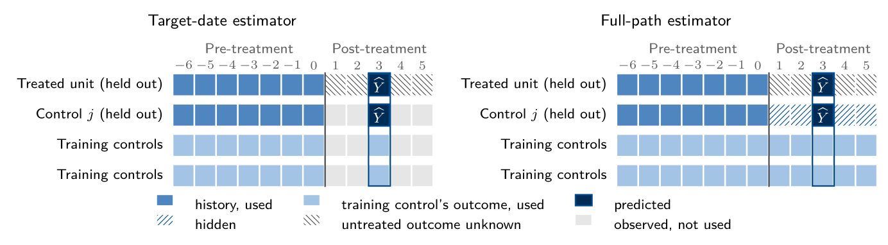
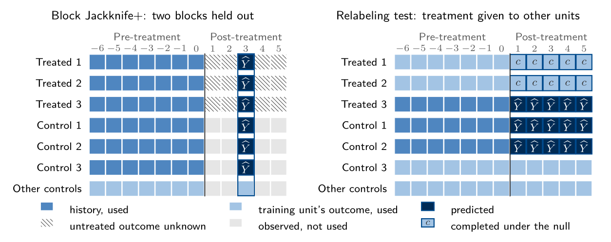

# Conformal Inference {#sec-conformal}

```{r .common, include = FALSE}
source("_common.R")
```

```{r conf-helpers, include = FALSE}
fmt <- function(x, digits = 2) formatC(x, format = "f", digits = digits)
library(ggplot2)
nf <- function(b) format(b, big.mark = ",")   # a count with a thousands comma
B.rank <- 20000; B.range <- 20000; B.naive <- 10000   # simulation runs
B.full <- 20000; B.split <- 20000; B.jp <- 5000
```

With one treated unit, there is no variation across treated units for the bootstrap or jackknife to resample. Conformal inference ranks the treated unit's prediction error among the prediction errors of the never-treated units, called controls. It gives an interval for each treated unit's effect at each date after treatment, with a guarantee that holds in finite samples.

`vartype = "conformal"` (new in 2.4.9) uses the Jackknife+ of @liuxu2026conformal for `method = "gsynth"`, `"ife"` and `"mc"` when the treatment never switches off. For `method = "fe"` and for `conformal_sc()`, it uses the paper's full conformal inference ([Section @sec-conformal-full]).

The chapter has five sections. [Section @sec-conformal-basics] builds the idea with ordinary data, with no panels. [Section @sec-conformal-panels] turns the draws into units of a panel and says what the guarantee needs. [Section @sec-conformal-one] shows `fect` with one treated unit, including a studentized score. [Section @sec-conformal-several] shows it with several treated units. [Section @sec-conformal-details] covers the checks of the assumption, the test for any effect, tuning, the comparison with the parametric bootstrap, the limits and a checklist. A reader who knows conformal inference can start at [Section @sec-conformal-panels].

## The idea {#sec-conformal-basics}

For an introduction to conformal inference with one sample, see [Samii's tutorial](https://cdsamii.github.io/cds-demos/conformal/conformal-tutorial.html) [-@samii2019conformal]. @shafer2008tutorial and @lei2018distribution give the formal treatments.

### One sample and a new draw {#sec-conformal-rank}

Start with nine draws from a skewed distribution and a tenth draw whose value is unknown. We do not need to know the distribution's shape.

```{r conf-rank-draws}
set.seed(2026)
y <- round(rexp(9), 2)
sort(y)
share_above <- function(u) mean(c(y, u) >= u)
```

Pick a candidate value `u` for the tenth draw. Add it to the nine and compute the share of the ten values at or above `u`. If `u` is `r max(y) + 0.5`, larger than all nine, the share is `r share_above(max(y) + 0.5)`. Only `u` itself is at or above it. If `u` is `r median(y)`, near the middle, the share is `r share_above(median(y))`.

Suppose the tenth value comes from the same distribution as the nine. Draw ten values from that distribution `r nf(B.rank)` times. Record the rank of the tenth, counting from the top.

```{r conf-rank-sim, cache = TRUE}
set.seed(2027)
rank.top <- replicate(B.rank, {
  v <- rexp(10)
  sum(v >= v[10])
})
round(table(rank.top) / B.rank, 3)
```

```{r conf-rank-fig, fig.width = 8, fig.height = 3.4, fig.show = "hold", fig.cap = "A candidate value, and the rank of a new draw"}
u <- 1.2
op <- par(mfrow = c(1, 2), mar = c(4.2, 4.4, 2.2, 1))
stack <- ave(seq_along(y), y, FUN = seq_along)
plot(y, stack, pch = 19, col = "grey40", ylim = c(0, 4), xlim = c(0, 6),
     xlab = "Value", ylab = "Draws at the same value", yaxt = "n",
     main = "(a) Nine draws and a candidate")
axis(2, at = 1:3)
abline(v = u, lty = 2, col = "#004a8c", lwd = 2)
text(u + 0.1, 3.6, paste("Share at or above u:", share_above(u)), adj = 0, col = "#004a8c")
rates <- table(rank.top) / B.rank
bars <- barplot(rates, ylim = c(0, 0.15), col = "grey75", border = NA, names.arg = rep("", 10),
                xlab = "Rank of the tenth value (1 = largest)", ylab = "Share of runs",
                main = "(b) Where the tenth value falls")
axis(1, at = bars, labels = 1:10, tick = FALSE, line = -0.5, gap.axis = 0, cex.axis = 0.9)
abline(h = 0.1, lty = 2, col = "#004a8c", lwd = 2)
par(op)
```

Each rank from 1 to 10 occurs in about one run in ten (right panel). The tenth value is the largest of the ten in `r fmt(mean(rank.top == 1), 3)` of runs.

Independent draws from one distribution are *exchangeable*: any ordering of them is as likely as any other. For exchangeable values, a new value is equally likely to take any rank among $N$ values. Its probability of being among the $k$ largest is at most $k/N$. It is exactly $k/N$ when no two values tie.

With 19 values, the range covers a new draw with probability at least $18/20$. This rank-based interval has a known level without an assumption about the distribution's shape. Take $n$ values and a new draw. The new draw falls outside the old values' range only if it is the smallest or largest of all $n + 1$. That has probability at most $2/(n + 1)$. The range therefore covers the new draw with probability at least $(n - 1)/(n + 1)$. We check this for two distributions.

```{r conf-rank-range, cache = TRUE}
set.seed(2028)
range_cover <- function(draw_values) {
  mean(replicate(B.range, {
    old <- draw_values(19)
    new <- draw_values(1)
    new >= min(old) & new <= max(old)
  }))
}
range.cover <- c(exponential = range_cover(rexp), normal = range_cover(rnorm),
                 rank.rule = (19 - 1) / (19 + 1))
range.cover
```

The range of 19 draws contains the 20th in `r fmt(range.cover["exponential"], 3)` of runs with exponential draws and `r fmt(range.cover["normal"], 3)` with normal draws. The rank argument gives `r fmt(range.cover["rank.rule"], 3)`. With `r nf(B.range)` runs, the Monte Carlo standard error is `r fmt(sqrt(0.9 * 0.1 / B.range), 3)`. The three numbers agree within simulation error.

### A naive band, and why it covers too rarely {#sec-conformal-naive}

We have 40 points $(x, y)$, where $y$ is a smooth curve of $x$ plus noise. We fit a degree 7 polynomial to predict the $y$ of a new point at $x_0$.

We form a band around the fitted value at $x_0$ using the fit's residuals, the differences between the data and the fitted values. Let `hw` be the `k`-th smallest absolute residual, with $k = \lceil 0.9 \times 40 \rceil$. Adding and subtracting this value gives a band containing 90 percent of the 40 residuals.

```{r conf-primer-setup}
alpha <- 0.1          # the error rate we accept
n <- 40               # points in the sample
N <- n + 1            # the sample plus the new point
deg <- 7              # degree of the polynomial
mc_se <- function(p, B) sqrt(p * (1 - p) / B)   # Monte Carlo standard error of a coverage
f <- function(x) sin(2 * x) + 0.5 * x     # the true curve
draw <- function(n) {
  x <- runif(n, -2, 2)
  data.frame(x = x, y = f(x) + rnorm(n, sd = 0.5))
}
```

```{r conf-naive-fit, fig.width = 6.5, fig.height = 4, fig.cap = "The naive band"}
set.seed(11)
d <- draw(n)
fit <- lm(y ~ poly(x, deg), d)
k <- ceiling((1 - alpha) * n)
hw <- unname(sort(abs(resid(fit)))[k])
c(k = k, hw = hw)
x0 <- 0.9
grid <- data.frame(x = seq(-2, 2, length.out = 200))
grid$fit <- predict(fit, grid)
fit0 <- as.numeric(predict(fit, data.frame(x = x0)))
ggplot(d, aes(x = x, y = y)) +
  geom_ribbon(data = grid, aes(y = fit, ymin = fit - hw, ymax = fit + hw),
              fill = "#cfe0f0", alpha = 0.8) +
  geom_point(colour = "grey40") +
  geom_line(data = grid, aes(y = fit), colour = "#004a8c") +
  geom_vline(xintercept = x0, linetype = "dashed", colour = "grey50") +
  annotate("segment", x = x0, xend = x0, y = fit0 - hw, yend = fit0 + hw,
           colour = "#004a8c", linewidth = 1.6) +
  labs(x = "x", y = "y") +
  theme_bw()
```

The band contains `r sum(abs(resid(fit)) <= hw)` of the 40 points used to build it. We check coverage of a new point over `r nf(B.naive)` runs. Each time we draw 40 points and a new one. We fit the model, build the band, and check whether the new `y` is inside. We also record the mean absolute residual in the sample and the absolute error on the new point.

```{r conf-naive-sim, cache = TRUE}
set.seed(12)
naive <- replicate(B.naive, {
  tr <- draw(n)
  new <- draw(1)
  ft <- lm(y ~ poly(x, deg), tr)
  r <- abs(resid(ft))
  err <- as.numeric(abs(new$y - predict(ft, new)))
  c(hit = as.numeric(err <= sort(r)[k]), residual = mean(r), new.error = err)
})
round(rowMeans(naive), 3)
```

The band contains the new point in `r fmt(mean(naive["hit", ]), 3)` of runs (Monte Carlo standard error `r fmt(mc_se(mean(naive["hit", ]), ncol(naive)), 3)`), below the requested 0.9. The mean absolute residual is `r fmt(mean(naive["residual", ]), 2)`. The mean absolute error on a new point is `r fmt(mean(naive["new.error", ]), 2)`.

The model was fitted to the 40 points, so their residuals are too small to represent errors on new points. The new point is not in the fit. The remedy is to measure the error on points the fit has not seen, which the next two subsections do in two ways.

### Full conformal {#sec-conformal-candidates}

Full conformal inference has three steps: add the new point with a candidate value `cand` for its unknown $y$, refit, and rank the candidate's error among the 41 errors. Add the point $(x_0, \texttt{cand})$ to the 40, refit, and compute the 41 absolute residuals. Let $p(\texttt{cand})$ be the share of the 41 at or above the candidate's absolute residual. Keep the candidates with $p > \alpha$ to form the interval. This is the full conformal inference of @vovk2005algorithmic, in the form of @lei2018distribution for regression.

```{r conf-full-pvalue}
p_full <- function(cand, x0, d) {
  aug <- rbind(d, data.frame(x = x0, y = cand))   # add the candidate
  r <- abs(resid(lm(y ~ poly(x, deg), aug)))      # refit, 41 absolute residuals
  mean(r >= r[nrow(aug)])                         # share at or above the candidate's
}
pred0 <- as.numeric(predict(fit, data.frame(x = x0)))
cands <- seq(pred0 - 3, pred0 + 3, length.out = 241)
pv <- sapply(cands, p_full, x0 = x0, d = d)
kept <- range(cands[pv > alpha])
c(lower = kept[1], upper = kept[2], width = diff(kept), naive.width = 2 * hw)
```

```{r conf-full-fig, fig.width = 6.5, fig.height = 4, fig.cap = "The p-value of each candidate"}
ggplot(data.frame(cand = cands, p = pv), aes(x = cand, y = p)) +
  geom_step(colour = "grey40") +
  geom_hline(yintercept = alpha, linetype = "dashed", colour = "grey50") +
  annotate("segment", x = kept[1], xend = kept[2], y = 0, yend = 0,
           colour = "#004a8c", linewidth = 2) +
  labs(x = "Candidate value for the new y",
       y = "Share at or above the candidate's error") +
  theme_bw()
```

The dashed line is $\alpha$. The candidates whose $p$ lies above it, marked in blue on the horizontal axis, run from `r fmt(kept[1], 2)` to `r fmt(kept[2], 2)`. The kept set is wider than the naive band, which has width `r fmt(2 * hw, 2)`.

If the candidate is the true value, the fit treats all 41 points alike. Their errors are then exchangeable, so the rank argument applies. The true value is rejected only when its error is among the $\lfloor \alpha N \rfloor$ largest. This has probability at most $\lfloor \alpha N \rfloor / N$. The set therefore covers the true value with probability at least $1 - \lfloor \alpha N \rfloor / N$, which is at least $1 - \alpha$.

```{r conf-full-level}
fc_k <- function(N, alpha) sum(seq_len(N) / N <= alpha)   # largest rank that rejects
1 - fc_k(N, alpha) / N
```

The guarantee is `r fmt(1 - fc_k(N, alpha) / N, 3)`. Each candidate requires a refit. In the simulation, we refit once per run with the true new `y` included. The true value is kept exactly when its $p$ exceeds $\alpha$.

```{r conf-full-sim, cache = TRUE}
set.seed(13)
full_sim <- t(replicate(B.full, {
  tr <- draw(n)
  new <- draw(1)
  r <- abs(resid(lm(y ~ poly(x, deg), rbind(tr, new))))
  c(x0 = new$x, hit = as.numeric(mean(r >= r[N]) > alpha))
}))
c(coverage = mean(full_sim[, "hit"]), mc.se = mc_se(mean(full_sim[, "hit"]), nrow(full_sim)))
```

The simulated coverage is `r fmt(mean(full_sim[, "hit"]), 3)` over `r nrow(full_sim)` runs, with Monte Carlo standard error `r fmt(mc_se(mean(full_sim[, "hit"]), nrow(full_sim)), 3)`. Without ties, full conformal covers at exactly `r fmt(1 - fc_k(N, alpha) / N, 3)` on average over data sets. Simulated coverage varies around that value.

### Split conformal and the Jackknife+ {#sec-conformal-honest}

Split conformal and the Jackknife+ measure errors on points excluded from the fit that predicts them. Neither requires a loop over candidates.

**Split conformal.**

Split the 40 points at random into two halves of 20. Fit on the first half. Score the second half by its absolute prediction errors. The band around a new prediction has half-width equal to the $k$-th smallest of those 20 errors, where $k = \lceil (m + 1)(1 - \alpha) \rceil$ and $m = 20$.

```{r conf-split-fit, fig.width = 6.5, fig.height = 4, fig.cap = "The 20 prediction errors on the held-out half"}
set.seed(31)
m <- n / 2
half <- sample(n, m)                                  # the half that fits the model
fit.split <- lm(y ~ poly(x, deg), d[half, ])
err.split <- sort(abs(d$y[-half] - predict(fit.split, d[-half, ])))
k.split <- ceiling((m + 1) * (1 - alpha))
c(k = k.split, half.width = unname(err.split[k.split]))
ggplot(data.frame(order = seq_len(m), error = err.split, kth = seq_len(m) == k.split),
       aes(x = order, y = error, colour = kth)) +
  geom_hline(yintercept = err.split[k.split], linetype = "dashed", colour = "grey50") +
  geom_point() +
  scale_colour_manual(values = c("grey50", "#004a8c"), guide = "none") +
  labs(x = "Errors ordered by size", y = "Absolute prediction error") +
  theme_bw()
```

The new point's error and the 20 errors on the held-out half are exchangeable because the fit used none of those points. The new error is equally likely to take any rank among the 21 errors. The band misses when it is larger than the $k$-th smallest of the 20, with probability $(m + 1 - k)/(m + 1)$. The band therefore covers with probability $k/(m + 1) =$ `r k.split`/`r m + 1` = `r fmt(k.split / (m + 1), 3)`. Only half the data are used to fit the model. The band depends on one random split.

```{r conf-split-sim, cache = TRUE}
set.seed(14)
split_sim <- t(replicate(B.split, {
  tr <- draw(n)
  new <- draw(1)
  h <- sample(n, m)
  ft <- lm(y ~ poly(x, deg), tr[h, ])
  e <- sort(abs(tr$y[-h] - predict(ft, tr[-h, ])))
  c(x0 = new$x, hit = as.numeric(abs(new$y - predict(ft, new)) <= e[ceiling((m + 1) * (1 - alpha))]))
}))
c(coverage = mean(split_sim[, "hit"]), mc.se = mc_se(mean(split_sim[, "hit"]), nrow(split_sim)))
```

The simulated coverage is `r fmt(mean(split_sim[, "hit"]), 3)` over `r nrow(split_sim)` runs, with Monte Carlo standard error `r fmt(mc_se(mean(split_sim[, "hit"]), nrow(split_sim)), 3)`. Split conformal covers at exactly `r fmt(k.split / (m + 1), 3)` on average over data sets. Simulated coverage varies around that value.

**The Jackknife+.** For each of the 40 points $j$, fit without $j$ and predict the new point. Measure $j$'s prediction error $R_j$ from the same fit. Each point is used for fitting and scoring, but never for the same prediction. Fold $j$ gives an interval for the new $y$, from $a_j = \text{prediction}_j - R_j$ to $b_j = \text{prediction}_j + R_j$. The Jackknife+ interval runs from the $q$-th smallest $a_j$ to the $q$-th largest $b_j$, where $q$ is the largest integer with $(2q - 1)/N \le \alpha$. Its guarantee is $1 - (2q - 1)/N$.

```{r conf-jp-folds, fig.width = 6.5, fig.height = 4, fig.cap = "The 40 fold intervals"}
jp_q <- function(N, alpha) sum((2 * seq_len(N %/% 2) - 1) / N <= alpha)
folds <- t(sapply(seq_len(n), function(j) {
  ft <- lm(y ~ poly(x, deg), d[-j, ])                 # fit without point j
  R <- as.numeric(abs(d$y[j] - predict(ft, d[j, ])))            # j's error in this fit
  p <- as.numeric(predict(ft, data.frame(x = x0)))    # prediction for the new point
  c(a = p - R, b = p + R)
}))
q <- jp_q(N, alpha)
jp <- c(lower = sort(folds[, "a"])[q], upper = sort(folds[, "b"], decreasing = TRUE)[q])
c(q = q, jp, level = 1 - (2 * q - 1) / N)
fd <- as.data.frame(folds)
fd$order <- rank(fd$a, ties.method = "first")
ggplot(fd) +
  geom_segment(aes(x = a, xend = b, y = order, yend = order), colour = "grey70", linewidth = 0.4) +
  geom_vline(xintercept = jp, colour = "#004a8c", linewidth = 0.8) +
  labs(x = "Interval for the new y", y = "Folds ordered by lower endpoint") +
  theme_bw()
```

With $N =$ `r N`, we get $q =$ `r q` and a guarantee of `r fmt(1 - (2 * q - 1) / N, 3)`. The interval runs from `r fmt(jp[1], 2)` to `r fmt(jp[2], 2)`.

Take $q = 1$. The interval misses only if, in every fold $j$, the new point's error is larger than point $j$'s error. Form a table whose entry $(i, k)$ is $i$'s error when $i$ and $k$ are both left out. Compare $i$ with $k$ by checking whether $i$'s entry is larger. For any pair, at most one point has the larger error.

Thus, at most one of the $N$ points can have a larger error than every other point in these comparisons. By exchangeability, the new point is that one with probability at most $1/N$. For larger $q$, the same count allows at most $2q - 1$ such points.

```{r conf-jp-sim, cache = TRUE}
set.seed(15)
jp_sim <- t(replicate(B.jp, {
  tr <- draw(n)
  new <- draw(1)
  ab <- t(sapply(seq_len(n), function(j) {
    ft <- lm(y ~ poly(x, deg), tr[-j, ])
    R <- as.numeric(abs(tr$y[j] - predict(ft, tr[j, ])))
    p <- as.numeric(predict(ft, new))
    c(a = p - R, b = p + R)
  }))
  lo <- sort(ab[, "a"])[jp_q(N, alpha)]
  hi <- sort(ab[, "b"], decreasing = TRUE)[jp_q(N, alpha)]
  c(x0 = new$x, hit = as.numeric(new$y >= lo & new$y <= hi))
}))
c(coverage = mean(jp_sim[, "hit"]), mc.se = mc_se(mean(jp_sim[, "hit"]), nrow(jp_sim)))
```

The simulated coverage is `r fmt(mean(jp_sim[, "hit"]), 3)` over `r nrow(jp_sim)` runs, with Monte Carlo standard error `r fmt(mc_se(mean(jp_sim[, "hit"]), nrow(jp_sim)), 3)`. This is above the guarantee of `r fmt(1 - (2 * q - 1) / N, 3)`.

The plain jackknife fits once on all 40 points and centers its interval on that fit's prediction of the new point. It uses the 40 leave-one-out errors as the margin. The Jackknife+ also uses each leave-one-out fit to predict the new point, so each error is paired with the prediction of the same fit. This added step is the "+". @barber2021predictive introduced the Jackknife+. They show that the plain jackknife has no coverage guarantee of this kind and that the Jackknife+ has one for any fitting rule that treats the points symmetrically. The jackknife standard errors of [Chapter @sec-inference] (`vartype = "jackknife"`) are a different use of leave-one-out fits.

Their theorem guarantees coverage of at least $1 - 2\alpha$ for the interval cut at the $\alpha$ and $1 - \alpha$ quantiles of the fold endpoints. The rule here chooses $q$ to make the guarantee $1 - \alpha$. Their proof uses the same table and count. @liuxu2026conformal prove this rule for panels. The chapter's `alpha` is the guarantee's `alpha`.

### What the guarantee gives {#sec-conformal-guarantee}

The guarantee is about a new point drawn in the same way as the old ones, averaged over the sample and the new point.

- **It is finite-sample.** It holds at $n = 40$.
- **It is marginal.** It is an average over new points, so it does not say the band covers at a particular $x_0$. We can see this by splitting the simulations above by where the new point fell.

```{r conf-guarantee-region}
by_region <- function(s) {
  c(far.from.centre = mean(s[abs(s[, "x0"]) > 1.6, "hit"]),
    near.centre = mean(s[abs(s[, "x0"]) <= 1.6, "hit"]))
}
round(rbind(full = by_region(full_sim), jackknife = by_region(jp_sim), split = by_region(split_sim)), 2)
```

Coverage differs by region for all three procedures, while the overall coverage is close to its level.

- **It covers one interval at a time.** Across many new points, about `alpha` of the intervals will miss. The guarantee does not say that all the intervals cover at once.
- **A poor model gives wider bands.** The bands remain valid.

## The panel setting {#sec-conformal-panels}

### A panel case: Proposition 99 {#sec-conformal-case}

In 1988, California passed Proposition 99, which raised the cigarette tax and paid for tobacco control. @abadie2010synthetic estimate its effect on cigarette sales by comparing California with states that adopted no comparable program. We use their Proposition 99 data from the **tidysynth** package. The data count 1989 as the first treated year.

```{r conformal-prop99-data}
data("smoking", package = "tidysynth")
p99 <- data.frame(id = smoking$state, time = smoking$year, Y = smoking$cigsale)
p99$D <- as.integer(p99$id == "California" & p99$time >= 1989)
length(unique(p99$id))
range(p99$time)
```

The panel contains `r length(unique(p99$id))` states, California and `r length(unique(p99$id)) - 1` controls, observed from `r min(p99$time)` to `r max(p99$time)`. Install the two packages needed for the data.

```{r conformal-install, eval = FALSE}
install.packages(c("tidysynth", "scpi"))   # only for the data of Proposition 99 and German reunification
```

```{r conformal-prop99-plot, fig.width = 7, fig.height = 5, fig.cap = "Cigarette sales in California and the control states"}
library(panelView)
panelview(Y ~ D, data = p99, index = c("id", "time"), type = "outcome",
          xlab = "Year", ylab = "Cigarette sales (packs per capita)", main = "",
          color = c("#4fa3e8", "#002b55", "grey80"), lwd = 1.2,
          legend.labs = c("Control states", "California, before 1989", "California, 1989 on"))
```

The figure uses **panelView**, with `type = "outcome"`. Each line shows one state's cigarette sales by year. The control states are grey. California is the only treated state. Its line is light blue up to `r min(p99$time[p99$D == 1]) - 1` and dark blue from `r min(p99$time[p99$D == 1])`, when treatment starts. The legend identifies these periods.

```{r conformal-prop99-numbers, include = FALSE}
avg_sales <- function(year, california) {
  mean(p99$Y[p99$time == year & (p99$id == "California") == california])
}
```

California's sales fall from `r fmt(avg_sales(1988, TRUE), 1)` packs per person in 1988 to `r fmt(avg_sales(2000, TRUE), 1)` in 2000. The control states' average falls from `r fmt(avg_sales(1988, FALSE), 1)` to `r fmt(avg_sales(2000, FALSE), 1)`. Sales fall everywhere. We estimate how much of California's decline the program caused.

Treat each control state in turn as if it had adopted the program in 1989. Predict its sales the way we predict California's, and compute its prediction error. California's prediction error should be comparable to the controls' errors. An error larger than almost all of theirs is evidence of a program effect.

For the application of [Section @sec-conformal-basics] to this panel, see [Section @sec-conformal-units]. For estimates with `conformal_sc()`, see [Section @sec-conformal-full].

### Units as the draws {#sec-conformal-units}

The California panel has one treated unit and $J =$ `r length(unique(p99$id)) - 1` controls, so $N = J + 1 =$ `r length(unique(p99$id))` units. In a panel, units correspond to draws. The treated unit's untreated outcome after 1988 is the new point whose value is missing. The estimated effect is the observed outcome minus the predicted untreated outcome. Subtract the interval for the untreated outcome from the observed outcome to get an interval for the effect.

The control states correspond to the old draws, with untreated outcomes known in every year. California corresponds to the new draw, with untreated outcomes known only before 1989.

California's `r length(unique(p99$time))` yearly values are not draws, because the years of one unit are serially dependent and can drift. Comparing California with other units needs neither stationarity nor random assignment of the treatment.

The units' prediction errors must be exchangeable. Relabeling the units must not change the errors' joint distribution. Any ordering of the errors must be as likely as any other. A *common prediction rule* predicts every held-out unit the same way. See [Section @sec-conformal-assumptions] for the conditions.

As in [Section @sec-conformal-honest], each control is held out because its fitted error is too small ([Section @sec-conformal-naive]). The units used to fit the model are the *training units*. The units whose outcomes are hidden are the *held-out units*. Synthetic control is fitted to closely match a unit's path before 1989. A band from California's in-sample errors would be narrow. This close fit gives little information about prediction errors from 1989 to 2000.

Use difference in differences to predict outcomes in 2000. Suppose the program had no effect. California's observed 2000 outcome is then its untreated outcome. Predict every state, including California, from the other states in the same way. Add its own 1970 to 1988 average to the other states' average change from their own averages to 2000.

```{r conformal-prop99-strip, fig.width = 6.5, fig.height = 4, fig.cap = "California's error among the errors of all states, 2000"}
Y <- tapply(p99$Y, list(p99$time, p99$id), sum)          # years by states
pre <- as.numeric(rownames(Y)) < 1989
at <- which(rownames(Y) == "2000")
base <- colMeans(Y[pre, ])                               # each state's own 1970-1988 average
change <- Y[at, ] - base                                 # each state's change to 2000
pred <- base + sapply(seq_along(change), function(i) mean(change[-i]))
err <- Y[at, ] - pred                                    # prediction error of each state
rank.ca <- sum(abs(err) >= abs(err["California"]))
p.hand <- rank.ca / length(err)
# the same number from the package
did <- conformal_sc(Y ~ D, data = p99, index = c("id", "time"), rule = "did", alpha = 0.1)
stopifnot(isTRUE(all.equal(p.hand, did$unit$p.value[did$unit$time == 2000])))
strip <- data.frame(error = sort(abs(err)), who = names(sort(abs(err))) == "California")
strip$order <- seq_len(nrow(strip))
ggplot(strip, aes(x = error, y = order, colour = who)) +
  geom_point() +
  scale_colour_manual(values = c("grey60", "#004a8c"), guide = "none") +
  labs(x = "Absolute prediction error in 2000 (packs per capita)", y = "States ordered by error") +
  theme_bw()
```

Counting from the top, California's error has rank `r rank.ca` of `r length(err)`. The share of states whose error is at least as large is `r rank.ca`/`r length(err)` = `r fmt(p.hand, 3)`. This is the p-value that `conformal_sc()` reports for 2000 with the rule `"did"`. If the program had no effect, California's error would be this large or larger in that share of relabelings. California is the blue point. The synthetic control rule of [Section @sec-conformal-full] gives California a different rank and p-value.

### Two kinds of estimator {#sec-conformal-estimators}

Synthetic control and fixed-effects imputation with one treated unit are *target-date* estimators. A target-date estimator predicts a date using only the pre-treatment outcomes and the controls' outcomes at that date. Generalized synthetic control, interactive fixed effects and matrix completion are *full-path* estimators. A full-path estimator may also use the controls' outcomes at other post-treatment dates. The figure's left panel shows a target-date estimator. The right panel shows a full-path estimator that also uses the controls' later outcomes. The held-out control's whole post-treatment path is therefore hidden.

```{r conformal-fold-task, echo = FALSE, out.width = "100%", fig.cap = "Each control is given the treated unit's task."}

```

Rows are units and columns are dates. The outlined column is the date being predicted. Adapted from the illustration in @liuxu2026conformal.

The table maps the idea of [Section @sec-conformal-basics] onto `fect`.

| Idea in the primer | What it becomes in a panel | Where in `fect` |
|---|---|---|
| A new draw ranked among old draws | The treated unit's prediction error ranked among the controls' errors | all procedures |
| A naive band from the fit's own residuals covers too rarely | A control's in-sample residual is too small, so each control is held out as if it were treated | all procedures |
| Full conformal: add the candidate, refit, rank | Complete the treated unit's untreated outcome with `Y - c`, hold out each unit in turn, rank the absolute errors of the $N$ units | target-date estimators: `method = "fe"`, `conformal_sc()` ([Section @sec-conformal-full]); the relabeling test is the same idea applied to blocks, with the candidate set to no effect ([Section @sec-conformal-relabel]) |
| Split conformal: score points excluded from the fit | Not used by `fect`; it motivates the Jackknife+ | none |
| The Jackknife+: each point is used for fitting and scoring, but never for the same prediction | Hold out the treated unit together with each control, and use the control's error as the margin around the treated unit's fold prediction | full-path estimators: `vartype = "conformal"` with `"gsynth"`, `"ife"`, `"mc"` ([Section @sec-conformal-fullpath]); also `conformal_sc(procedure = "jackknife+")` |
| One new point | One treated unit at one date | averages over several treated units: the block Jackknife+ (`conformal.block = TRUE`, [Section @sec-conformal-block]) |
| A marginal guarantee, one interval at a time | Over units, at each date separately | `overlap_check()` on the raw outcomes, the `loading.overlap` plot and the pre-treatment diagnostics (`conformal.diag`) look for evidence against the key condition ([Section @sec-conformal-checks]) |

With a full-path estimator, full conformal inference needs a candidate for every post-treatment outcome of the treated unit. We therefore use the Jackknife+ for full-path estimators.

### The Jackknife+ in a panel {#sec-conformal-idea}

In the regression of [Section @sec-conformal-honest], the new point is absent from the data. In a panel, each fold must hide the treated unit's outcomes after adoption because its untreated outcomes are unknown (see the figure in [Section @sec-conformal-estimators]).

Take one treated unit, one date after treatment and $J$ never-treated controls. In the fold for control $j$, hold out the treated unit and control $j$ together from the adoption date on. Keep the other controls' full panels. Control $j$'s known outcome at the date gives its prediction error $R_j$, which measures the fold's prediction error. The fold predicts the treated unit's untreated outcome, written $\hat M_{0j}$. Adding and subtracting the control's prediction error gives the endpoints $\hat M_{0j} - R_j$ and $\hat M_{0j} + R_j$.

Let $N = J + 1$. The interval for the untreated outcome runs from the $q$-th smallest lower endpoint to the $q$-th largest upper endpoint, where $q$ is the largest integer with $(2q - 1)/N \le$ `alpha`. Subtracting it from the observed outcome gives the interval for the effect. It covers the effect with probability at least $1 - (2q - 1)/N$. The table gives this guarantee for several $N$, next to that of full conformal inference ([Section @sec-conformal-full]), $1 - \lfloor \alpha N \rfloor / N$.

```{r conf-levels}
jp_level <- function(N, alpha) {
  q <- jp_q(N, alpha)
  if (q == 0) "whole line" else fmt(1 - (2 * q - 1) / N, 3)
}
fc_level <- function(N, alpha) {
  kk <- fc_k(N, alpha)
  if (kk == 0) "whole line" else fmt(1 - kk / N, 3)
}
Ns <- c(10, 17, 20, 39, 46)
levels.tab <- data.frame(
  N = Ns,
  jackknife.0.1 = sapply(Ns, jp_level, alpha = 0.1),
  full.0.1 = sapply(Ns, fc_level, alpha = 0.1),
  jackknife.0.05 = sapply(Ns, jp_level, alpha = 0.05),
  full.0.05 = sapply(Ns, fc_level, alpha = 0.05)
)
knitr::kable(levels.tab, align = "r",
             col.names = c("N", "Jackknife+, alpha = 0.1", "Full, alpha = 0.1",
                           "Jackknife+, alpha = 0.05", "Full, alpha = 0.05"))
```

The row N = `r length(unique(p99$id))` is Proposition 99 ([Section @sec-conformal-germany] gives the N of German reunification). With 19 controls and `alpha = 0.1`, $N = 20$, $q =$ `r jp_q(20, 0.1)` and the guarantee is `r jp_level(20, 0.1)`. With 45 controls, $N = 46$, $q =$ `r jp_q(46, 0.1)` and the guarantee is `r jp_level(46, 0.1)`.

The guarantee is at least $1 -$ `alpha` and can be higher, because $N$ is a whole number. With fewer than $1/$`alpha` $- 1$ controls, $q = 0$ and the interval is the whole real line. Each interval also has a p-value for no effect at that date. It is at most `alpha` exactly when the interval excludes zero, and it is at least $1/N$.

### What the guarantee needs {#sec-conformal-assumptions}

- **The treated unit is no harder to predict than the controls.** A treated unit whose factor loadings lie outside the controls' range is predicted by extrapolation. Its errors can be larger than any control's. The condition usually fails when a treated unit differs from every control, as in this example. Formally, take the table of pair errors, whose entry for units $i$ and $k$ is unit $i$'s error when the two are held out together. The table's distribution must not change when the units are relabeled, rows and columns together.
- **The tuning is fixed in advance.** Every fold reuses the original fit's number of factors `r` (or `lambda` for `"mc"`). If that number was chosen by cross-validation, the choice depends on the data in ways that can favor one group. See [Section @sec-conformal-tuning].
- **No anticipation and no reversal.** Outcomes before adoption are untreated, and treatment stays on once it starts.
- **Enough controls.** About $1/$`alpha` or more never-treated units, as above.

The guarantee does not require a correct factor model, stationary errors, or a long pre-treatment period. A poor model makes the intervals wider. They keep their guarantee if the model is equally poor for the treated unit and the controls. To look for evidence against the first condition, start with `overlap_check()` and then use the other checks in [Section @sec-conformal-checks].

## One treated unit {#sec-conformal-one}

### Proposition 99 with `conformal_sc()` {#sec-conformal-full}

Synthetic control and the two-way fixed-effects imputation of `method = "fe"` (one treated unit, controls observed at every date) are target-date estimators ([Section @sec-conformal-estimators]). For target-date estimators, the paper recommends full conformal inference, the procedure of [Section @sec-conformal-candidates] applied to units.

A candidate effect $c$ replaces the candidate $y$. Set the treated unit's untreated outcome at the date to its observed outcome minus $c$. Hold out each unit alone, including the treated unit, and refit with the candidate included. The treated unit's error is $\hat\tau - c$. The p-value of $c$ is the share of units whose absolute error is at least the treated unit's. Keep the candidates with p-value above `alpha`.

As in [Section @sec-conformal-candidates], the set covers the effect with probability at least $1 - \lfloor \alpha N \rfloor / N$ if the errors are exchangeable at the true effect. For the fixed-effects rule and synthetic control, each unit's error is a straight-line function of $c$. Thus, `fect` finds the set exactly, without a grid of candidates.

With the absolute score and these two estimators, the set is always one interval because every control's weight on the treated unit lies between 0 and 1. A user-written rule can give the treated unit a larger weight. The set can then be a union of intervals. In that case, `CI.lower` and `CI.upper` give its hull, and `disconnected` is `TRUE`.

`conformal_sc()` gives conformal inference for synthetic control and other target-date estimators. The estimator is a *rule*: `"sc"` (the default: synthetic control with simplex weights fitted on the pre-treatment outcomes; requires **quadprog**), `"did"` (difference in differences from [Section @sec-conformal-units]), or a user-written function ([Section @sec-conformal-rule]). Choose `procedure = "full"` (the default) for full conformal sets or `procedure = "jackknife+"` for Jackknife+ intervals. These calls reproduce the paper's synthetic control results for Proposition 99 and German reunification. We request four pre-treatment dates as diagnostics.

```{r conformal-full-sc, cache = TRUE}
out.sc <- conformal_sc(Y ~ D, data = p99, index = c("id", "time"),
                       alpha = 0.1, diag = 4)
print(out.sc)
```

The output shows one row per year after 1988, with the estimate, set, p-value and `N`. Its header reports the guaranteed level. `out.sc$unit` contains the set for each date. `out.sc$avg` contains the set for the effect averaged over the post-treatment dates. The guarantee for the average requires the units' errors averaged over the dates to be exchangeable.

`out.sc$diag` contains the four placebo dates before 1989, where the true effect is zero. The output's last line counts how many reject zero. The same call with `procedure = "jackknife+"` gives Jackknife+ intervals, shown alongside the full conformal sets in the table.

```{r conformal-full-sc-jp, cache = TRUE}
out.jp <- conformal_sc(Y ~ D, data = p99, index = c("id", "time"),
                       procedure = "jackknife+", alpha = 0.1, diag = 4)
cmp <- data.frame(event.time = out.sc$unit$event.time,
                  full.lower = out.sc$unit$CI.lower,
                  full.upper = out.sc$unit$CI.upper,
                  jackknife.lower = out.jp$unit$CI.lower,
                  jackknife.upper = out.jp$unit$CI.upper)
round(cmp, 2)
c(full = out.sc$unit$level[1], jackknife = out.jp$unit$level[1])
```

```{r conformal-prop99-fig, fig.width = 6.5, fig.height = 4.2, fig.cap = "Full conformal sets and Jackknife+ intervals"}
plot(out.sc, out.jp, ylab = "Effect on sales (packs per capita)")
```

Each point is the estimate for a period after treatment, with the full conformal set in dark blue and the Jackknife+ interval in light blue. The axis counts periods since treatment, and period 1 is `r min(out.sc$unit$time)`. The four dates left of the vertical line are the pre-treatment diagnostics.

```{r conformal-prop99-numbers2, include = FALSE}
excl <- function(u) u$CI.lower > 0 | u$CI.upper < 0
ex.fc <- excl(out.sc$unit)
ex.jp <- excl(out.jp$unit)
ex.dg <- excl(out.sc$diag)
```

There are $N =$ `r out.sc$unit$N[1]` units. Both procedures guarantee `r fmt(out.sc$unit$level[1], 3)`. The estimated effect is negative in `r sum(out.sc$unit$eff < 0)` of the `r nrow(out.sc$unit)` years after 1988. The full conformal set excludes zero in `r sum(ex.fc)` of the `r nrow(out.sc$unit)` years: `r paste(out.sc$unit$time[ex.fc], collapse = ", ")`. The Jackknife+ intervals exclude zero in `r sum(ex.jp)` of the years. `r sum(ex.dg)` of the `r nrow(out.sc$diag)` pre-treatment dates reject zero.

The median width is `r fmt(median(out.sc$unit$CI.upper - out.sc$unit$CI.lower), 1)` for full conformal inference and `r fmt(median(out.jp$unit$CI.upper - out.jp$unit$CI.lower), 1)` for the Jackknife+. Full conformal sets cover at about their level. Jackknife+ intervals usually have higher coverage and are then wider.

The set for the effect averaged over the `r out.sc$avg$n.dates` years runs from `r fmt(out.sc$avg$CI.lower, 1)` to `r fmt(out.sc$avg$CI.upper, 1)`. The average estimate is `r fmt(out.sc$avg$eff, 1)`. Its p-value is `r fmt(out.sc$avg$p.value, 3)`, or `r round(out.sc$avg$p.value * out.sc$avg$N)`/`r out.sc$avg$N`. California's average error has rank `r round(out.sc$avg$p.value * out.sc$avg$N)` from the top among the `r out.sc$avg$N` units. These statements hold if California is no harder to predict than the controls, under the conditions in [Section @sec-conformal-assumptions].

### A smaller panel: German reunification {#sec-conformal-germany}

The German reunification data are those of @abadie2015comparative, taken from the **scpi** package. The treated unit is West Germany from 1990. The outcome is GDP per capita.

```{r conformal-germany-data}
data("scpi_germany", package = "scpi")
ger <- data.frame(id = scpi_germany$country, time = scpi_germany$year, Y = scpi_germany$gdp)
ger$D <- as.integer(ger$id == "West Germany" & ger$time >= 1990)
c(countries = length(unique(ger$id)), years = length(unique(ger$time)))
```

```{r conformal-germany-fit}
fc.g <- conformal_sc(Y ~ D, data = ger, index = c("id", "time"), alpha = 0.1, diag = 4)
jp.g <- conformal_sc(Y ~ D, data = ger, index = c("id", "time"),
                     procedure = "jackknife+", alpha = 0.1, diag = 4)
fc.g95 <- conformal_sc(Y ~ D, data = ger, index = c("id", "time"), alpha = 0.05)
fc.p95 <- conformal_sc(Y ~ D, data = p99, index = c("id", "time"), alpha = 0.05)
```

```{r conformal-germany-fig, fig.width = 6.5, fig.height = 4.2, fig.cap = "Full conformal sets and Jackknife+ intervals, West Germany"}
plot(fc.g, jp.g, ylab = "Effect on GDP per capita (thousand USD)")
```

The axis counts periods since treatment again, and period 1 is `r min(fc.g$unit$time)`.

```{r conformal-germany-numbers, include = FALSE}
ex.g <- excl(fc.g$unit)
```

There are $N =$ `r fc.g$unit$N[1]` units. Both procedures guarantee `r fmt(fc.g$unit$level[1], 3)`. Of the `r nrow(fc.g$unit)` post-treatment years, `r sum(ex.g)` full conformal sets and `r sum(excl(jp.g$unit))` Jackknife+ intervals exclude zero. Of the diagnostics, `r sum(excl(fc.g$diag))` of `r nrow(fc.g$diag)` reject zero. The average effect over the `r fc.g$avg$n.dates` years is `r fmt(fc.g$avg$eff, 2)`. Its set runs from `r fmt(fc.g$avg$CI.lower, 1)` to `r fmt(fc.g$avg$CI.upper, 1)`. Its p-value is `r fmt(fc.g$avg$p.value, 3)`, or `r round(fc.g$avg$p.value * fc.g$avg$N)`/`r fc.g$avg$N`.

With `r fc.g$n.controls` controls, a 95 percent set is the whole line. At `alpha = 0.05`, the set for the average runs from `r format(fc.g95$avg$CI.lower)` to `r format(fc.g95$avg$CI.upper)`. For California's `r fc.p95$n.controls` controls, `alpha = 0.05` gives a finite set for the average, from `r fmt(fc.p95$avg$CI.lower, 1)` to `r fmt(fc.p95$avg$CI.upper, 1)`. Its guarantee is `r fmt(fc.p95$avg$level, 3)`, or $1 - 1/`r fc.p95$avg$N`$. Count the units before choosing the level.

### A studentized score {#sec-conformal-studentized}

With the absolute score, no full conformal set for West Germany excludes zero (`r sum(ex.g)` of the `r nrow(fc.g$unit)` years). The set's width follows the controls' prediction errors. A control that the method fits badly has a large error and widens the set at every date.

The *studentized score* divides each unit's prediction error by the size of that unit's own pre-treatment residuals, measured as their root mean squared value. A unit that the method fits closely before treatment is held to a smaller error. We run both procedures with `score = "studentized"` and the same four pre-treatment dates.

```{r conformal-stud-fit, cache = TRUE}
fs.g <- conformal_sc(Y ~ D, data = ger, index = c("id", "time"), alpha = 0.1,
                     diag = 4, score = "studentized")
js.g <- conformal_sc(Y ~ D, data = ger, index = c("id", "time"), alpha = 0.1,
                     diag = 4, score = "studentized", procedure = "jackknife+")
```

```{r conformal-stud-numbers, include = FALSE}
sg <- fs.g$sigma[fs.g$sigma$time == min(fs.g$unit$time), ]
sg.wg <- sg$sigma[sg$unit == "West Germany"]
rk <- rank(sg$sigma)[sg$unit == "West Germany"]
rk.txt <- if (rk <= 3) c("smallest", "second smallest", "third smallest")[rk] else paste0(rk, "th smallest")
ex.sf <- excl(fs.g$unit)
ex.sj <- excl(js.g$unit)
```

The studentized full conformal sets exclude zero in `r sum(ex.sf)` of the `r nrow(fs.g$unit)` years (`r paste(fs.g$unit$time[ex.sf], collapse = ", ")`). The studentized Jackknife+ intervals exclude zero in `r sum(ex.sj)`. With the absolute score the counts are `r sum(ex.g)` and `r sum(excl(jp.g$unit))`. Of the four pre-treatment dates, `r sum(excl(fs.g$diag))` reject zero with full conformal inference and `r sum(excl(js.g$diag))` with the Jackknife+, as they should when the effect is zero. The studentized score gives no set for the average over the post-treatment dates. With this score a set can be a union of intervals, some of them unbounded. `CI.lower` and `CI.upper` then give its hull, `disconnected` is `TRUE`, the parts are in `components`, and the plot draws the hull.

The change comes from West Germany's pre-treatment residuals. Their root mean squared value is `r fmt(sg.wg, 4)`, the `r rk.txt` of the `r nrow(sg)` units. Dividing by it enlarges West Germany's score relative to the controls'.

```{r conformal-stud-fig, fig.width = 6.5, fig.height = 4.2, fig.cap = "Studentized full conformal sets and Jackknife+ intervals, West Germany"}
plot(fs.g, js.g, ylab = "Effect on GDP per capita (thousand USD)")
```

The axis again counts periods since treatment, and period 1 is `r min(fs.g$unit$time)`. Adding `y.axis = "t"` to the call divides the estimate and the ends of each set by the treated unit's pre-treatment residual size, which puts treated units with different scales on one axis; it is not a t-statistic.

```{r conformal-stud-t, eval = FALSE}
plot(fs.g, js.g, y.axis = "t")
```

Choose the score before looking at the post-treatment results. If the choice depends on which score excludes zero, the guarantee no longer holds. The pre-treatment residual sizes do not depend on the post-treatment outcomes, so they can inform the choice. Here the largest unit's size is `r fmt(max(sg$sigma) / min(sg$sigma), 0)` times the smallest. The paper defines the studentized score for the post-treatment dates. Applying it at the pre-treatment dates, with each date's weights taken from the dates before it, is an extension in `fect`.

`fect(method = "fe", vartype = "conformal", conformal.score = "studentized")` takes the same option. It is not available for `"gsynth"`, `"ife"` or `"mc"`.

### Fixed effects and factor models with `fect()` {#sec-conformal-fullpath}

```{r conformal-sim-numbers, include = FALSE}
data(sim_gsynth)
treated <- unique(sim_gsynth$id[sim_gsynth$D == 1])
n.tr <- length(treated)                                    # treated units of sim_gsynth
n.co <- length(unique(sim_gsynth$id)) - n.tr               # never-treated controls
n.per <- length(unique(sim_gsynth$time))                   # periods
```

Proposition 99 used target-date estimators. For a full-path estimator (`"gsynth"`, `"ife"`, `"mc"`), `fect()` uses the Jackknife+ of [Section @sec-conformal-idea]. The simulated data `sim_gsynth`, from [Chapter @sec-gsynth], have `r n.tr` treated units, `r n.co` never-treated controls, `r n.per` periods and two factors. We keep the first treated unit and the `r n.co` controls.

```{r conformal-one-data}
data(sim_gsynth)
treated <- unique(sim_gsynth$id[sim_gsynth$D == 1])
d1 <- subset(sim_gsynth, !(id %in% treated[-1]))
length(unique(d1$id))
```

Make three changes to a `gsynth` fit: use `vartype = "conformal"`, fix the number of factors with `CV = FALSE`, and set `alpha` to the accepted error rate.

```{r conformal-one-fit}
out.cf1 <- fect(Y ~ D + X1 + X2, data = d1, index = c("id", "time"),
                method = "gsynth", force = "two-way", r = 2, CV = FALSE,
                se = TRUE, vartype = "conformal", alpha = 0.1)
print(out.cf1)
```

The intervals for each date are in `out.cf1$conformal$unit`. The columns `N` and `q` give the pool size and the endpoint used.

```{r conformal-one-unit}
cu1 <- out.cf1$conformal$unit
cu1[, c("time", "event.time", "eff", "CI.lower", "CI.upper", "p.value", "N", "q")]
```

Read the second row. At the second period after treatment, the estimated effect is `r round(cu1$eff[2], 2)`. The interval runs from `r round(cu1$CI.lower[2], 2)` to `r round(cu1$CI.upper[2], 2)`. With $N =$ `r cu1$N[2]` and $q =$ `r cu1$q[2]`, it covers the effect with probability at least `r fmt(1 - (2 * cu1$q[2] - 1) / cu1$N[2], 3)` if the conditions above hold. Its p-value, `r round(cu1$p.value[2], 3)`, equals $1/`r cu1$N[2]`$, the smallest possible with `r cu1$N[2] - 1` controls. The interval for the first period `r if (cu1$CI.lower[1] <= 0 && cu1$CI.upper[1] >= 0) "includes" else "excludes"` zero.

The gap plot draws the same intervals, because with one treated unit the average effect at each event time is that unit's effect.

```{r conformal-one-gap, fig.width = 6, fig.height = 4.5}
plot(out.cf1, main = "One treated unit, conformal intervals")
```

Each interval has its guarantee at its own date. The guarantees are not joint. With a guarantee of `r fmt(1 - (2 * cu1$q[2] - 1) / cu1$N[2], 3)` at each of the `r nrow(cu1)` dates, up to `r fmt((2 * cu1$q[2] - 1) / cu1$N[2], 3)` of the intervals can miss on average. `est.avg` also reports an interval for the average effect over the `r nrow(cu1)` dates. With one treated unit, @liuxu2026conformal cover such averages if the errors averaged over the dates are exchangeable across units.

**The fixed-effects model.** `vartype = "conformal"` also works with `method = "fe"`. We show no example. The fixed-effects imputation is a target-date estimator, so `fect()` runs full conformal inference, the procedure of [Section @sec-conformal-full] with the difference-in-differences rule, and not the Jackknife+. It applies without covariates. With one treated unit, the event-time rows of `est.att` hold its sets at each date, and `est.avg` holds the set for its effect averaged over the post-treatment dates. With several treated units, `fect` reports a set for each unit and date in `fit$conformal$unit` and each unit's average in `fit$conformal$avg`. The averages over units in `est.att` and `est.avg` have no interval. With staggered adoption, each treated unit is compared with the never-treated units over its own pre-treatment dates, and `fect` says when this target-date estimate differs from its ordinary estimate. The guarantee still requires the treated unit to be no harder to predict than the controls under this model. Use it where a fixed-effects model is credible, for example where the units share a common trend.

### A rule of your own {#sec-conformal-rule}

The rule below adds the held-out unit's average pre-treatment gap from the training units to their mean at the target date. A user-written rule takes three arguments: the held-out unit's outcomes at the pre-treatment dates, the training units' outcomes at those dates (one column per unit), and the training units' outcomes at the target date. It returns the held-out unit's prediction at the target date without using that unit's outcome at that date.

```{r conformal-full-rule}
my_rule <- function(query.pre, background.pre, background.target) {
  mean(background.target) + mean(query.pre - rowMeans(background.pre))
}
out.my <- conformal_sc(Y ~ D, data = p99, index = c("id", "time"),
                       rule = my_rule, alpha = 0.1)
head(out.my$unit[, c("time", "eff", "CI.lower", "CI.upper", "method")])
```

For a user-written rule, `fect` checks numerically whether the prediction is a straight-line function of the completed outcome. If so, the set is exact (`method` is `"exact"`). If not, the p-value is evaluated on a grid of candidates (`grid`). The grid spacing determines the precision of the endpoints. `lower.truncated` or `upper.truncated` flags a set that reaches the grid's end.

The guarantee requires the treated unit to be no harder to predict than the controls under the rule. The rule and its tuning, such as a synthetic control penalty, must be fixed in advance and the same for every unit. Use the Jackknife+ when the rule is not a straight-line function of the outcomes. The grid requires a refit of every control at each candidate.

## Several treated units {#sec-conformal-several}

We use all `r n.tr` treated units of `sim_gsynth` in the `gsynth` call of [Section @sec-conformal-fullpath].

```{r conformal-fit, cache = TRUE}
out.cf <- fect(Y ~ D + X1 + X2, data = sim_gsynth, index = c("id", "time"),
               method = "gsynth", force = "two-way", r = 2, CV = FALSE,
               se = TRUE, vartype = "conformal", alpha = 0.1)
print(out.cf)
```

```{r conformal-several-numbers, include = FALSE}
N.cf <- out.cf$conformal$unit$N[1]
q.cf <- jp_q(N.cf, 0.1)
```

### An interval for each unit and date {#sec-conformal-unit}

Each of the `r n.tr` treated units gets its own intervals, computed from the same `r n.co` controls as before. Under the conditions of [Section @sec-conformal-assumptions], each covers that unit's effect at that date with probability at least `r fmt(1 - (2 * q.cf - 1) / N.cf, 3)`, since $N =$ `r N.cf` and $q =$ `r q.cf`.

```{r conformal-unit-plot, fig.width = 8, fig.height = 4.5, fig.cap = "Conformal intervals for each treated unit"}
cu <- out.cf$conformal$unit
ggplot(cu, aes(x = event.time, y = eff)) +
  geom_hline(yintercept = 0, linetype = "dashed", colour = "grey50") +
  geom_pointrange(aes(ymin = CI.lower, ymax = CI.upper), size = 0.2) +
  facet_wrap(~ unit, nrow = 1, axes = "all") +
  scale_x_continuous(breaks = seq(2, 10, by = 2)) +
  labs(x = "Periods since treatment", y = "Effect on Y") +
  theme_bw()
```

### Block Jackknife+ for the average effect {#sec-conformal-block}

For the average effect over the treated units, use the block Jackknife+ of @liuxu2026conformal. Without `conformal.block = TRUE`, the averages in `est.att`, `est.avg` and the gap plot have intervals with no guarantee, and we do not recommend reporting them. In a constructed example in `?fect`, such an interval covers the average effect with probability 0.42 at a nominal 0.90. `print()` and the caption of the gap plot say so.

The figure compares three treated units with a block of controls of the same size. The block Jackknife+ makes this comparison with the treated units as a group.

```{r conformal-block-task, echo = FALSE, out.width = "100%", fig.cap = "A treated block is compared with a block of controls of the same size."}

```

Three treated units are shown, while the example has `r n.tr`. Left: the treated block and one block of three controls are held out together. One fit predicts all six units. Each block is scored by its average error. Right: the relabeling test ([Section @sec-conformal-relabel]) assigns the treatment pattern to another set of three units and refits. Adapted from the illustration in @liuxu2026conformal.

With `conformal.block = TRUE`:

1. The controls are split at random into blocks as large as the treated group.
2. Each control in a block is matched with one treated unit and takes that unit's pre-treatment window and adoption date.
3. Each fold hides the treated units and one block from their adoption dates on. It fits the model once.
4. The fold predicts the average from the treated units' predictions. Its error is the absolute average error of the block's controls at the same dates.

The interval then follows the rule in [Section @sec-conformal-idea], with the blocks in place of the controls.

The guarantee holds for the average effect even when effects differ across treated units, provided the treated block is as easy to predict as a block of controls. The partition is random. To reproduce it, call `set.seed()` before the fit or pass `seed`. With staggered adoption, each control takes its matched unit's adoption date. The average at an event time uses the treated units observed then and their matched controls.

The fit uses `alpha = 0.1`, pre-treatment diagnostics, and the relabeling test from [Section @sec-conformal-details]. We set `seed` because the partition and the relabeling draws are random.

```{r conformal-block, cache = TRUE}
out.cfb <- fect(Y ~ D + X1 + X2, data = sim_gsynth, index = c("id", "time"),
                method = "gsynth", force = "two-way", r = 2, CV = FALSE,
                se = TRUE, vartype = "conformal", alpha = 0.1,
                conformal.block = TRUE, conformal.diag = 4,
                conformal.relabel = 999, seed = 1234)
print(out.cfb)
```

```{r conformal-block-numbers, include = FALSE}
bk <- out.cfb$conformal$block
bk.alpha <- out.cfb$conformal$gamma
bk.level <- 1 - (2 * bk$q - 1) / bk$N
bk.min <- round(1 / bk.alpha - 1)
```

The fit has `r bk$K` treated units and `r n.co` controls. It forms `r bk$G` blocks of `r bk$K`. The remaining `r bk$n.training` controls are training units. Counting the treated block, $N =$ `r bk$N`.

At `alpha = ` `r bk.alpha`, $q =$ `r bk$q` and the guarantee is $1 - (2 \times `r bk$q` - 1)/`r bk$N` =$ `r fmt(bk.level, 2)`. A finite interval needs at least `r bk.min` blocks, that is, at least `r bk.min` controls for each treated unit. Controls with missing outcomes are excluded from the blocks.

The partition is in `out.cfb$conformal$block$partition`. In the gap plot, the intervals after treatment are block Jackknife+ intervals, and the four dates before treatment show the diagnostics.

```{r conformal-block-gap, fig.width = 6, fig.height = 4.5, fig.cap = "Average effect with block Jackknife+ intervals"}
plot(out.cfb, main = "Average effect, block Jackknife+ intervals")
```

## Diagnostics and additional details {#sec-conformal-details}

### Checking the assumption {#sec-conformal-checks}

The guarantee requires the treated units to be no harder to predict than the controls. Three checks can find evidence against this condition, in the order below. No test can prove it.

**The overlap check on the raw outcomes.** `overlap_check()` needs no factor model, no number of factors and no post-treatment outcome. [Chapter @sec-gsynth] describes it and its plots. For each treated unit, subtract from its path and from each control's path their means over the treated unit's pre-treatment dates. Rebuild the treated unit's path as a weighted average of the controls' paths, with nonnegative weights that sum to one. The unit's fit error is the root mean squared gap between its path and the rebuild over those dates. Do the same for each control, rebuilt from the other controls. The check flags the treated unit when its error exceeds the `level` quantile of the controls' errors. @liuxu2026conformal use 0.90. A flag means that the unit's pre-treatment path may lie outside the range of the controls' paths.

```{r conformal-overlap-check}
oc <- overlap_check(Y ~ D, data = sim_gsynth, index = c("id", "time"), level = 0.90)
oc
```

```{r conformal-overlap-numbers, include = FALSE}
fl <- oc$units[oc$units$flag, ]
```

The check flags `r oc$summary$n.flagged` of the `r oc$summary$n.tr` treated units of `sim_gsynth`: unit `r paste(fl$unit, collapse = ", ")`. Its error is `r fmt(fl$error[1], 2)`, against `r fmt(fl$yardstick[1], 2)` for the `r oc$level` quantile of the `r oc$summary$n.co` controls' errors. It is rebuilt worse than `r round(100 * fl$pct[1])` percent of the controls. `plot(oc)` draws, for each treated unit, its gap: the unit's demeaned outcome minus its rebuild, in each period before its first treated period. The grey lines are the controls' own gaps, each control rebuilt from the others. The shaded region holds the controls' gaps in each period up to the `level` quantile of their absolute size.

```{r conformal-overlap-check-plot, fig.width = 8, fig.height = 5, fig.cap = "The overlap check: each treated unit's gap before treatment"}
plot(oc)
```

A unit the controls can follow has a gap that stays mostly inside the region and crosses zero. Unit 105's gap, in red with a pink region, leaves the region in several periods, above and below it. A gap that leaves the region in several periods, or that trends or stays on one side of zero near adoption, belongs to a unit the controls cannot follow. The flag compares the unit's error over the whole window with the controls' errors, so a single excursion is not a flag.

The same check on the two real panels:

```{r conformal-overlap-real}
oc.p99 <- overlap_check(Y ~ D, data = p99, index = c("id", "time"), level = 0.90)
oc.ger <- overlap_check(Y ~ D, data = ger, index = c("id", "time"), level = 0.90)
oc.p99
oc.ger
```

```{r conformal-overlap-real-numbers, include = FALSE}
better.ca <- sum(oc.p99$yard[["California"]] < oc.p99$units$error)
better.ge <- sum(oc.ger$yard[["West Germany"]] < oc.ger$units$error)
```

California's error is `r fmt(oc.p99$units$error, 2)`, against `r fmt(oc.p99$units$yardstick, 2)` for the controls' `r oc.p99$level` quantile. Of the `r oc.p99$units$n.donors` controls, `r better.ca` are rebuilt better, so it is not flagged. West Germany's error is `r fmt(oc.ger$units$error, 3)`, against `r fmt(oc.ger$units$yardstick, 3)`. Of the `r oc.ger$units$n.donors` controls, `r better.ge` are rebuilt better, so it is not flagged either. The check in @liuxu2026conformal flags neither unit. The gaps show the same.

```{r conformal-overlap-p99-plot, fig.width = 7, fig.height = 4, fig.cap = "The overlap check: California's gap before treatment"}
plot(oc.p99)
```

```{r conformal-overlap-ger-plot, fig.width = 7, fig.height = 4, fig.cap = "The overlap check: West Germany's gap before treatment"}
plot(oc.ger)
```

In both figures the unit's gap stays inside the shaded region in every period and crosses zero.

A flag is a reason to investigate whether the treated unit is harder to predict than the controls. It does not show that exchangeability fails. A unit that passes is not shown to be as easy to predict, because the check cannot see differences in levels, which the demeaning removes, or factors that are flat before treatment. The check has no formal false positive guarantee.

**Where the treated units' loadings lie.** For a factor model, a treated unit whose loadings lie far from the controls' is predicted by extrapolation. The `loading.overlap` plot from [Chapter @sec-gsynth] shows the control loadings, their convex hull, and the treated units' loadings.

```{r conformal-overlap, fig.width = 6, fig.height = 5, fig.cap = "Loadings of the controls and of the treated units"}
plot(out.cf, type = "loading.overlap")
```

The plot has no unit labels, so we count the units inside the hull. A point is inside if it lies on the same side of every edge.

```{r conformal-hull}
L <- out.cf$lambda.co
Tr <- out.cf$lambda.tr
hull <- L[rev(chull(L)), , drop = FALSE]
inside <- function(p, P) {
  m <- nrow(P)
  side <- sapply(seq_len(m), function(i) {
    a <- P[i, ]
    b <- P[i %% m + 1, ]
    (b[1] - a[1]) * (p[2] - a[2]) - (b[2] - a[2]) * (p[1] - a[1])
  })
  all(side >= 0) || all(side <= 0)
}
in.hull <- apply(Tr, 1, inside, P = hull)
tr.ids <- sort(treated)[as.integer(rownames(Tr))]   # fect numbers the treated units in sorted order
c(inside = sum(in.hull), treated = length(in.hull))
tr.ids[!in.hull]
```

In this fit, `r sum(!in.hull)` of the `r length(in.hull)` treated units lie outside the controls' hull (units `r paste(tr.ids[!in.hull], collapse = ", ")`). Check their pre-treatment diagnostics closely because their intervals depend more on the condition that they are no harder to predict than the controls. The two checks need not agree. The overlap check flags unit `r paste(fl$unit, collapse = ", ")` and no other.

**Pre-treatment diagnostics.** `conformal.diag = 4` runs the procedure at each treated unit's last four dates before treatment, as if the unit had adopted then. Its outcomes from that date on are hidden. Its outcome at that date is predicted from earlier dates and the controls. The estimate is a pseudo-effect, which should be zero because treatment had not started.

The interval and p-value test for zero effect. An interval excluding zero indicates that the unit was harder to predict than the controls before treatment. This weakens the evidence for the validity of its post-treatment intervals.

```{r conformal-diag}
du <- out.cfb$conformal$diag$unit
head(du[, c("unit", "time", "event.time", "eff", "CI.lower", "CI.upper",
            "p.value")], 8)
```

```{r conformal-diag-numbers, include = FALSE}
dx <- du$CI.lower > 0 | du$CI.upper < 0
dx.unit <- tapply(dx, du$unit, sum)
```

Of the diagnostic intervals, `r sum(dx)` of `r nrow(du)` exclude zero. The tests at these dates are not adjusted for multiple testing. With `alpha` set to `r out.cfb$conformal$gamma`, at most `r fmt(out.cfb$conformal$gamma * out.cfb$conformal$diag$m, 1)` of each unit's `r out.cfb$conformal$diag$m` intervals are expected to exclude zero by chance. Do not reject the assumption based on one miss. Investigate several misses.

The pre-treatment rows of `est.att` contain the average pseudo-effect at each of the four event times. They use the same kind of interval as the post-treatment rows (block Jackknife+ here).

In the Proposition 99 output of [Section @sec-conformal-full], `diag = 4` ran the procedure at `r nrow(out.sc$diag)` dates before 1989. Of these dates, `r sum(excl(out.sc$diag))` reject zero. The same check applies with one treated unit.

### Testing for any effect {#sec-conformal-relabel}

The intervals estimate the effect's size at each date. The relabeling test tests whether treatment had any effect. Under the sharp null of no effect in any treated cell, every observed outcome is untreated. The treated units are `r bk$K` units assigned adoption dates.

```{r conformal-relabel-stats}
rl <- out.cfb$conformal$relabel
n.ge <- sum(!is.finite(rl$draws.avg) | abs(rl$draws.avg) >= abs(rl$ATT.avg))
c(p.value = rl$p.value, observed = rl$ATT.avg, at.least.as.large = n.ge)
```

`conformal.relabel = 999` assigns the `r bk$K` adoption dates to `r bk$K` randomly drawn units, `r rl$B` times. Each time, it refits the model and records the average effect over the new treated cells. The p-value is the share of the `r nf(rl$B + 1)` assignments, including the actual assignment, whose absolute average effect is at least as large as the actual one. It is exact if the treated units, absent treatment, are as easy to predict as any `r bk$K` other units. With random assignment, it is Fisher's randomization test.

The p-value is `r fmt(rl$p.value, 3)`. Of the draws, `r n.ge` of `r rl$B` have an absolute average effect at least as large as the observed `r fmt(rl$ATT.avg, 2)`. Including the actual assignment gives $(1 + `r n.ge`)/`r rl$B + 1` =$ `r fmt((1 + n.ge) / (rl$B + 1), 3)`. The smallest possible p-value is $1/`r rl$B + 1` =$ `r fmt(1 / (rl$B + 1), 3)`.

The in-space placebo test of @abadie2010synthetic reassigns the intervention to each control unit and moves the treated unit into the donor pool. Under no effect, those fits coincide with holding out each unit at a candidate effect of zero, so ranking the treated unit's statistic among the controls' is a full conformal test ([Section @sec-conformal-candidates]). The relabeling test is the placebo test with several treated units. The usual implementation ranks the ratio of post- to pre-treatment root mean squared prediction error, a joint test of no effect at any post-treatment date, and rarely inverts it into a confidence set. The relabeling test above ranks the absolute average effect instead. Users should state two assumptions: every placebo fit uses the same estimator, tuning and donor-pool rule, keeps the treated unit in the donor pool and drops no unit for poor pre-treatment fit; and the statistics are exchangeable under the null, or the assignment is random.

The same draws give a p-value at each event time, in `out.cfb$conformal$relabel$att`. The plot shows each draw's average effect by period in grey and the actual one in blue. This is the placebo plot of the synthetic control literature, with `r bk$K` units reassigned at a time.

```{r conformal-relabel-plot, fig.width = 6, fig.height = 4.5, fig.cap = "Placebo paths and the observed path"}
paths <- data.frame(
  event.time = rep(as.numeric(rownames(rl$paths)), ncol(rl$paths)),
  eff = c(rl$paths),
  draw = rep(seq_len(ncol(rl$paths)), each = nrow(rl$paths))
)
ggplot(paths, aes(x = event.time, y = eff, group = draw)) +
  geom_line(colour = "grey80", linewidth = 0.3) +
  geom_hline(yintercept = 0, linetype = "dashed", colour = "grey50") +
  geom_line(data = rl$att, aes(x = event.time, y = ATT), inherit.aes = FALSE,
            colour = "#004a8c", linewidth = 1) +
  scale_x_continuous(breaks = seq(2, 10, by = 2)) +
  labs(x = "Periods since treatment", y = "Average effect on Y") +
  theme_bw()
```

The same test applies with one treated unit, where each draw gives the adoption date to one unit. `conformal.relabel` is available with `method = "gsynth"`, `"ife"` and `"mc"`. It is not available with `method = "fe"`.

### Tuning {#sec-conformal-tuning}

All these guarantees require tuning to be fixed in advance. Every fold, diagnostic, block and relabeling fit reuses the original fit's number of factors or `lambda`.

With `CV = TRUE`, that value is chosen from the data. With `method = "gsynth"`, the default cross-validation scores only the never-treated units' held-out cells. With `"ife"` and `"mc"`, it also scores the treated units' pre-treatment cells. Either choice can fit one group better than the other. The guarantee then no longer follows. `fect` prints a message naming the chosen value.

Pass a single number of factors (or `lambda`) with `CV = FALSE`, as in the examples above. If the number is unknown, choose it before looking at the outcomes, for example from theory or an earlier study. Report the choice. Cross-validation on the controls alone also favors one group and does not restore the guarantee. We also recommend showing that the conclusions hold for a nearby value.

### Conformal or parametric bootstrap? {#sec-conformal-vs-parametric}

Both are meant for few treated units. They answer different questions and rest on different conditions.

| | Parametric bootstrap | Conformal (Jackknife+) |
|---|---|---|
| Output | Standard errors and intervals for the average effect by period and overall | Intervals for each treated unit and date; averages through the block Jackknife+ |
| Guarantee | Approximate, as the numbers of controls and pre-treatment periods grow | Finite-sample, at each date |
| Main conditions | The factor model holds for every unit, `r` is at least the true number of factors, the controls' loadings span the factors, and errors are independent across units with the same distribution for treated units and controls | The treated units are no harder to predict than the controls, the tuning is fixed, and there are about $1/$`alpha` or more controls |
| Methods | `"gsynth"`, and `"ife"` or `"cfe"` with `time.component.from = "nevertreated"` | `"gsynth"`, `"ife"`, `"mc"` |

When both methods apply, they can be reported side by side. If they disagree, the parametric intervals depend on the error model, and the conformal intervals depend on the comparison with controls. [Chapter @sec-inference] explains the parametric bootstrap and its conditions.

### Limits {#sec-conformal-limits}

- There are no standard errors. `S.E.` is `NA`, and `ci.method` does not apply.
- Full conformal inference ([Section @sec-conformal-full]) covers target-date estimators only: `method = "fe"` without covariates, and the rules given to `conformal_sc()`.
- At least two never-treated units are needed, and about $1/$`alpha` of them for a finite interval.
- The diagnostics refit for each of their dates, and the relabeling test refits once per draw. With `"ife"` and `"mc"`, which fit once per held-out unit, `conformal.diag = 4` makes the run about five times longer.
- `vartype = "conformal"` stops with weights, `group`, `balance.period`, placebo and carryover tests, `loo`, permutation tests, `cm`, extra fixed effects, binary outcomes, `loading.bound` and treatments that switch off. The equivalence plot, `estimand()`, `att.cumu()`, `effect()` and `fect_sens()` need bootstrap draws and stop for these fits.
- If a fold fit fails, its control stays in the pool with an infinite score. The interval widens. `N` and `q` do not change. `fect` warns. See `?fect` for details.

### A checklist {#sec-conformal-summary}

A typical analysis with few treated units:

1. Choose `r` (or `lambda`) before looking at the outcomes after treatment, and fit with `CV = FALSE` ([Section @sec-conformal-tuning]).
2. Fit with `vartype = "conformal"`. With more than one treated unit, add `conformal.block = TRUE` for the average effect, and set `seed` ([Section @sec-conformal-block]).
3. Run `overlap_check()` on the raw outcomes. For a factor model, look at the `loading.overlap` plot. Add `conformal.diag = 4` and look at the pre-treatment intervals ([Section @sec-conformal-checks]).
4. Add `conformal.relabel = 999` to test whether there is any effect ([Section @sec-conformal-relabel]).
5. With a target-date estimator, such as the fixed-effects model with one treated unit or synthetic control, use full conformal inference: `method = "fe"` in `fect()`, or `conformal_sc()` ([Section @sec-conformal-full]). If the controls' pre-treatment residuals differ widely in size, consider the studentized score, chosen before looking at the post-treatment outcomes ([Section @sec-conformal-studentized]).
6. Report the intervals for each unit and date, the block interval for the average, the guarantee level (`print()` shows it), and the diagnostics.

## How to cite

For another introduction to conformal inference, see Samii's tutorial [@samii2019conformal]. The data come from the **tidysynth** [@dunford2025tidysynth] and **scpi** [@cattaneo2026scpi] packages and from `fect`.

Cite @liuxu2026conformal for conformal inference in **fect**.

```bibtex
@misc{liuxu2026conformal,
  title = {Unit-Level Conformal Inference for Panel Counterfactuals},
  author = {Liu, Ziyi and Xu, Yiqing},
  year = {2026},
  eprint = {2611.19209},
  archivePrefix = {arXiv},
  url = {https://arxiv.org/abs/2611.19209}
}
```
